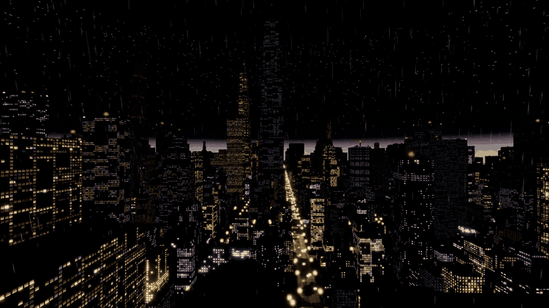
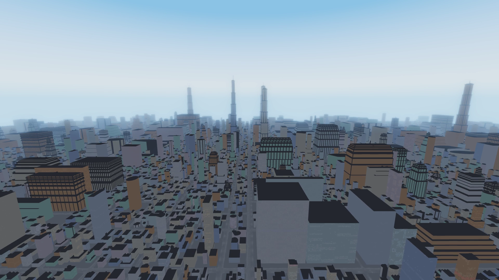
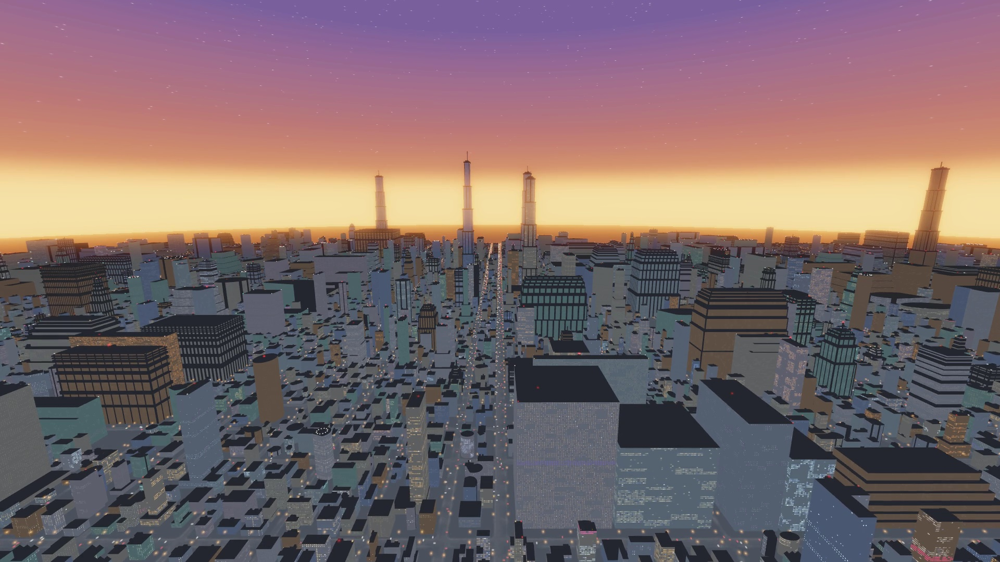
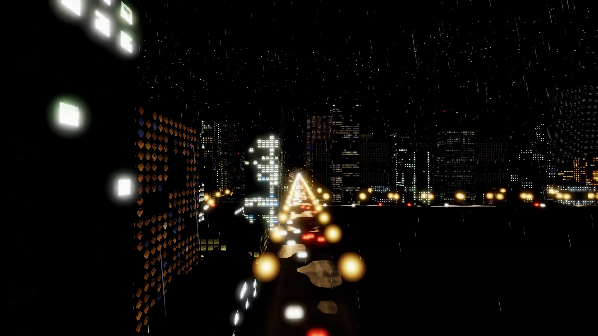
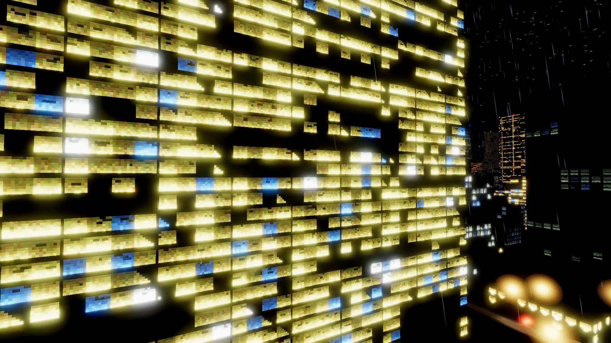
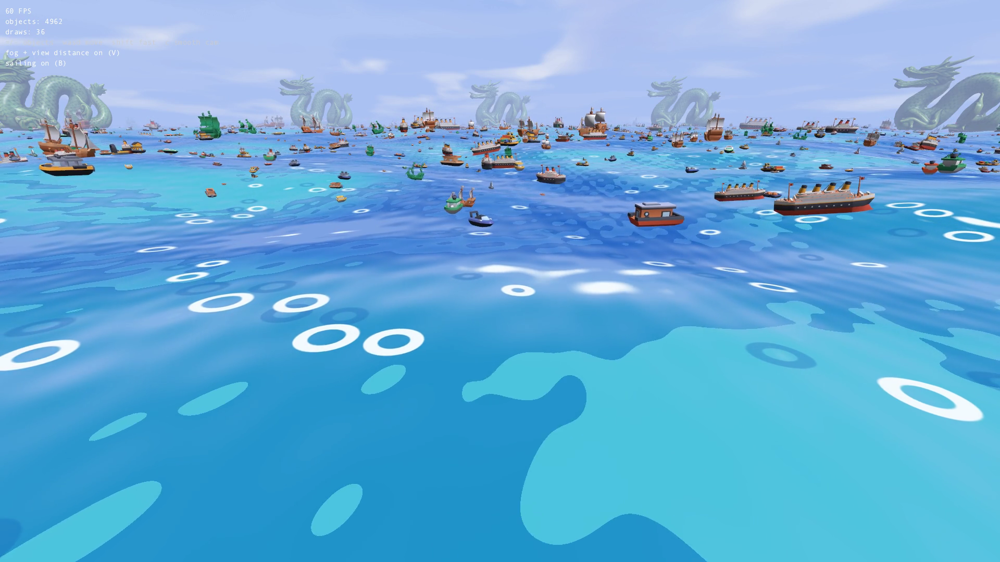
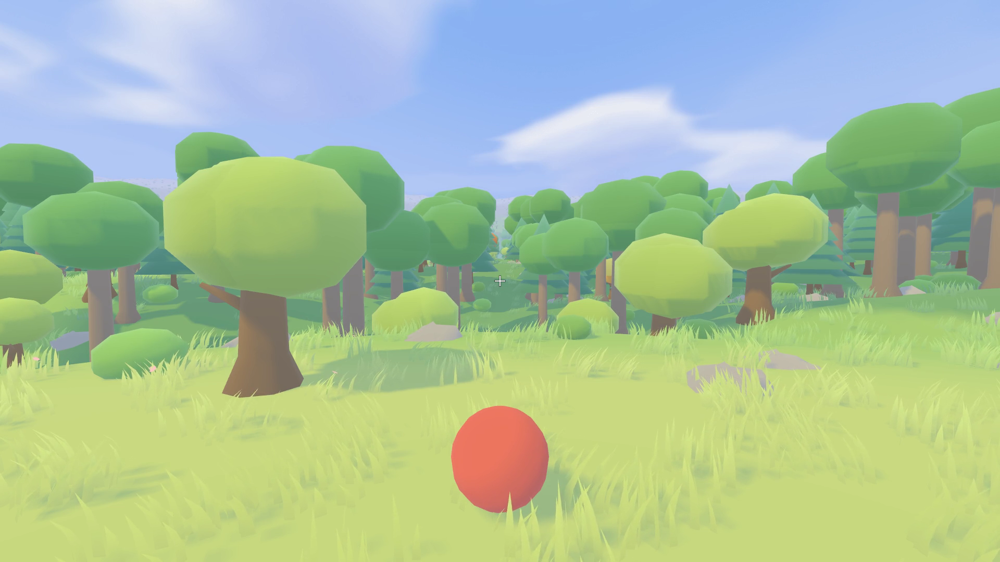
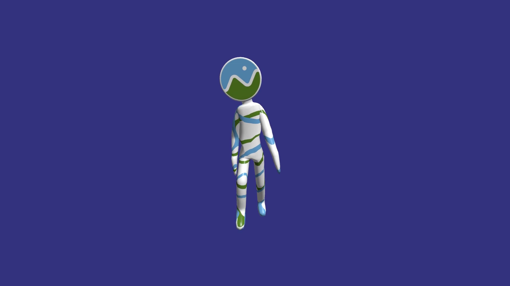
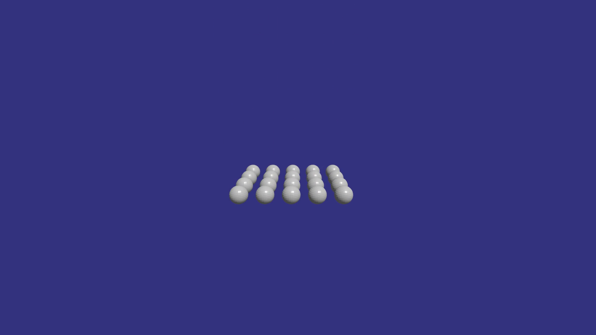
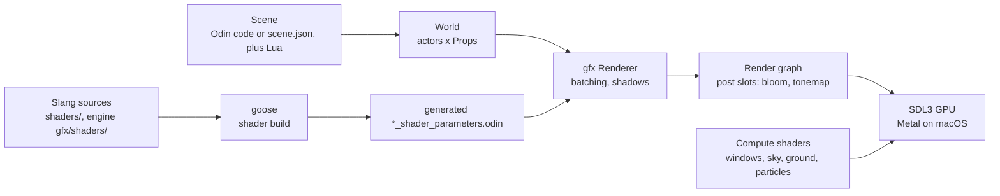

# Cubes

A small game engine in Odin, built on SDL3 GPU and Slang shaders, with a procedural
night city as its showcase scene. Everything is generated at runtime: the buildings,
window textures, sky and streets come from compute shaders, and the only art assets are
a few glTF models and textures.



[Full-length video (MP4)](media/city-hero.mp4)

## Highlights

- **Procedural city**: 3072 x 2048 unit plot with 19,024 buildings (363 skyscrapers, 460
  medium towers, 18,201 small blocks), about 1.5 M mesh vertices, 85 roads, 27,359 street
  lamps and 19,084 cars. Generated once per seed (`R` re-rolls it).
- **Compute-generated textures**: the window atlas, sky and ground are written by compute
  shaders at startup (`shaders/city_windows.slang`, `city_sky_gen.slang`,
  `city_ground_gen.slang`). No texture files are shipped for the city.
- **Day/night and weather**: a clock (`Y` / `Shift+Y` sets the hour, `U` toggles the cycle),
  weather cycle `V` (clear, rain, storm), storm lightning, wet street reflections.
- **GPU rain**: two layers of particles wrap inside a box that follows the camera
  (`src/scenes/city/rain.odin`, `T` toggles).
- **Lighting and post**: multi-level bloom (3 levels), tonemap with exposure (`[` / `]`),
  per-pixel distance fog from a shared shader include, trilinear sampling with 8x anisotropy.
- **Engine**: actors composed from Props in a `World`; scenes as JSON or Odin code with
  hot reload; LuaJIT scripts with hot reload; Box3D physics; GPU particles; a post-processing
  render graph; scene transitions and a scene stack; skeletal glTF animation.
- **Tooling**: offline video rendering (`--render-video`), camera paths (`J`/`K`/`L`),
  `F12` screenshots, a benchmark mode (`--bench`), and a scaffolding CLI
  (`make new-scene`, `make new-actor`).

## Gallery

| Scene | Preview | Run |
|---|---|---|
| City (day) |  | `make run ARGS=city` |
| City (sunset) |  | `make run ARGS=city`, then `Y` to change the hour |
| City (night, rain) |  | `make run ARGS=city`, then `V` for rain |
| City (storm) |  | `make run ARGS=city`, then `V` twice |
| Sea (boats, dragons) |  | `make run ARGS=benchmark` |
| Benchmark |  | `make run ARGS=benchmark` |
| Forest (instanced) |  | `make run ARGS=forest_instanced` |
| Character viewer |  | `make run ARGS=skinned`, then `Tab` to switch character, `Left`/`Right` for clips, `Space` for auto |
| Physics |  | `make run ARGS=physics` |

Every scene name in `SCENES` (`src/scene.odin`) can be passed to `make run ARGS=<name>`.
`make run` with no `ARGS` starts `benchmark`.

## Try it

Requirements:

- macOS on Apple Silicon (the only platform tested, see [Status](#status-and-limitations)).
- [Odin](https://odin-lang.org) on `PATH`, or `ODIN=/path/to/odin make ...`.
- `slangc`: the copy vendored in `third_party/goose`, or `SLANG=/path/to/slangc make ...`.

```sh
git clone --recurse-submodules https://github.com/LucasGobbs/cubes.git
cd cubes
make build
make run ARGS=city
```

`make run` opens the window fullscreen on monitor 2 (`SCREEN=` picks the monitor; it falls
back to the primary display when only one is present). Useful variants:

```sh
make run SCREEN=1 ARGS=city                 # monitor 1
make run ARGS="city --WINDOWED"             # windowed, through the compositor
./main city --display 2                     # same flag on the binary (1-based)
make run ARGS="city --WINDOWED --bench 2"   # run 2 s without input, print stats, exit
```

Asset paths (`static/...`) are relative to the working directory, so run from the repo root
(the `make` targets do this) or from inside `dist/`.

### Controls

City scene (`src/scenes/city/scene.odin`):

| Key | Action |
|---|---|
| `R` | Re-roll the city |
| `G` | Dev view (streets) |
| `B` | Bloom on/off |
| `F` | Distance fog on/off |
| `T` | Rain on/off |
| `O` | Auto-orbit camera |
| `Y` / `Shift+Y` | Hour +1 / -1 |
| `U` | Day cycle on/off |
| `V` | Weather: clear, rain, storm |
| `[` / `]` | Exposure down / up (0.25 EV) |
| `WASD`, mouse, `Space` / `LCtrl`, `LShift` | Fly (`Z` slow, `C` smooth toggle) |

Engine keys (all scenes):

| Key | Action | Source |
|---|---|---|
| `1`-`6` | Switch scene group (order of first appearance in `SCENES`) | `src/engine/scene_groups.odin` |
| `Q` / `E` | Previous / next scene in the group | `src/engine/host.odin` |
| `Shift` + number | Push that group's scene on the stack | `src/engine/host.odin` |
| `Backspace` | Pop the stack | `src/engine/host.odin` |
| `M` | Toggle MSAA | `src/engine/host.odin` |
| `F1` / `P` | Stats panel / log stats | `src/engine/stats.odin` |
| `F5` | Reload Lua scripts | `src/engine/host.odin` |
| `F12` | Save the frame as PNG in `shots/` (no overlays) | `src/engine/screenshot.odin` |
| `J` / `K` / `L` | Record camera key / save `camera.path.json` / play it back | `src/engine/camera.odin` |
| `Esc` | Quit | `src/engine/host.odin` |

### Offline capture

```sh
./main city --WINDOWED --render-video out.mp4 --fps 60 --seconds 20 --video-size 1280x720
./main city --WINDOWED --record camera.path.json   # replay a saved camera path
scripts/snap.sh city shot.png 3                     # window screenshot (macOS)
```

`--render-video` steps time at a fixed rate, so frames are independent of the machine's speed.
`--record` accepts either a six-number pose (`ex,ey,ez,tx,ty,tz`) or a JSON path.

## How it's built



- **Scene** (`src/scenes/<name>/`) registers hooks (`create`, `tick`, `destroy`) in `src/scene.odin`.
  Data scenes need no code: their JSON describes the actors and camera.
- **World** (`src/engine/world.odin`) holds actors. An actor is a struct embedding
  `engine.Actor`; its components are Props, and Lua can attach to any actor.
- **Renderer** (`src/engine/gfx/`) sorts draws by pipeline and material and runs post-processing
  passes registered per slot (`rgraph.odin`).
- **Shaders**: Slang sources in `shaders/` and `src/engine/gfx/shaders/`. `goose` compiles them
  and writes the Odin parameter structs; `make shaders` regenerates them.

### City history

The city was built one step per commit, with a tag per step. The tags are kept as development
history; the `city-*` tags can be listed with `git tag -l 'city-*'`.

- `city-01-sandbox`: empty scene, fly camera, dev background
- `city-02-window-grid`: compute-generated window texture on a row of cubes
- `city-03-window-detail`: light spill, fade, furniture, colour noise, window shapes
- `city-04-buildings`: cube, blocky, modern and classic generators
- `city-05-city-plan`: street grid and about 5000 buildings in two draws
- `city-06-window-groups`: 4x4 tile atlas, per-tile lit ratio, rooms
- `city-07-towers`: tiered towers with lids, stripes, taper, roof clutter
- `city-08-sky`: compute-generated sky, stars and clouds
- `city-09-lights-fog`: streetlights, bloom, per-pixel distance fog
- `city-10-streets`: ground painted from the road plan on the GPU
- `city-11-cars`: GPU-animated head and tail lights along lanes
- `city-12-polish`: auto-orbit camera and the first write-up
- `city-13-bloom-variety`: multi-scale bloom, round light sprites, 2048 city, mipmaps
- `city-14-night-lights`: darker night, varied windows, blinking roof beacons
- `city-15-window-glow`: window glow, 3072 x 2048 city
- `city-16-rain`: subtle rain, about 5x fewer drops
- `city-17-calmer-streets`: less traffic, brighter lit windows
- `city-18-day-night-weather`: day/night cycle, weather, lightning, wet streets, camera-following rain volume

### Measured performance

One `--bench 2` run on an M-series Mac, windowed 1280 x 720, 4x MSAA, 240 frames:
FPS average 120.0, minimum 97.1, maximum 154.2; frame time average 8.33 ms, p95 8.82 ms;
6 draw calls and about 879 k triangles per frame. Other machines and displays will differ.

## Remaining docs

### Scene files and transitions

A scene can be plain data: `src/scenes/<name>/scene.json` holds the name, camera (with optional
bloom) and actors (model, clip, position, rotation in degrees, scale). The format is documented
in `src/engine/scene_def.odin`. Data scenes reload when the file changes: the mtime is polled
every 0.25 s and the change is applied to the live world by actor name. `Ctrl+S` writes the live
state back to the file. A parse failure logs and keeps the running state.

```odin
engine.change_scene("forest_instanced", .Fade, 0.6)
```

Transitions (`src/engine/scene_change.odin`): `Cut`, `Flash`, `Blink`, `Fade`, `Fade_White`, `Wipe`.

`engine.push_scene(name, policy)` runs a scene on top of the current one; `engine.pop_scene()`
returns to it. The policy decides what happens to the scene underneath:

- `.Keep`: stays in memory, not ticked or drawn; pop restores it instantly.
- `.Disk`: `Scene.suspend` writes it to `.cache/scene_stack/`, it is destroyed; pop recreates it and calls `Scene.resume`.
- `.Discard`: destroyed; pop recreates it from scratch.

A scene may set `Scene.load`, which runs on a job thread before `create` (CPU work only, such as
parsing or decoding). The transition covers the screen with a progress bar until it finishes;
`engine.preload_scene(name)` starts it early. Data scenes decode models and textures this way.

### Forest scenes

Both are the same toon meadow: a 1024 x 1024 m world of 64 x 64 chunks of 16 m, streamed as the
camera moves, with grass at two LODs, wind, two-tone fog and a sun lens flare. They differ in
how trees, rocks and bushes are drawn (`F1` shows the counts):

- `forest_naive` (`src/scenes/forest_naive/`, `shaders/forest.slang`): each chunk is one
  world-space mesh with its trees baked in. Every tree is unique geometry.
- `forest_instanced` (`src/scenes/forest_instanced/`, `shaders/forest_instanced.slang`): 13
  variant meshes (oak, pine, broadleaf, autumn, rocks, bushes) are uploaded once, and every
  placed tree is an instance of one variant, so each variant is one instanced draw.

### Skeletal animation

`make run ARGS=skinned` opens a character viewer with three CC0 characters (Quaternius:
`mannequin`, `superhero_male`, `superhero_female`) and 18 clips each. Clips crossfade over
0.25 s. Tab switches character, Left/Right step clips, Space toggles auto mode (clips advance
on their own and the view turns slowly; a left drag stops the turn). Scene code is
`src/scenes/skinned/scene.odin`. Optional env: `CUBES_SKINNED_CHARACTER`, `CUBES_SKINNED_CLIP`,
`CUBES_SKINNED_AUTO=0|1`.

```odin
engine.spawn(&state.world,
    engine.Model{path = "static/models/superhero_male.glb"},
    engine.Animator{clip = "Idle_Loop"},
    engine.Transform{})
engine.actor_play(&state.world, actor, "Walk_Loop", 0.25)
```

- Linear-blend skinning, up to 4 joints per vertex; weights are normalized at import.
- Limits: 128 joints per skin (`MAX_JOINTS`, `src/engine/gfx/loader/skin.odin`) and 64 skinned
  instances per frame (`MAX_SKINNED_INSTANCES`, `src/engine/gfx/renderer.odin`).
- Only the first skin in a file is imported. Cubic-spline channels are skipped with a warning;
  linear and step interpolation are sampled.
- Skinned actors are never culled (no bounds are computed for them).
- Normals use the upper 3x3 of the blended skin matrix rather than its inverse transpose: exact
  for rotation and uniform scale, approximate for non-uniform joint scale.
- Bundled models: `rigged_cesiumman.glb` and `rigged_riggedsimple.glb`, CC-BY 4.0 (Cesium, via
  Khronos glTF-Sample-Assets). Sources and licences are in `static/models/README-rigged.txt`;
  keep that file with the models when redistributing.

### Lua scripting

An actor can run a LuaJIT behaviour: `engine.Script{path = "src/scenes/scriptdemo/spinner.lua"}`,
or `actor_hooks(T, lua = path)` on an Odin actor type. A Lua module returns a table with optional
hooks `create(self, a)`, `tick(self, a, dt)`, `fixed_tick`, `on_contact(self, a, other)`,
`reload` and `destroy`. Example (`src/scenes/scriptdemo/spinner.lua`):

```lua
local engine = require("engine")
local M = {}

function M.create(self, a)
  self.t = 0
  self.base_y = a:transform().position.y
end

function M.tick(self, a, dt)
  local t = a:transform()
  self.t = self.t + dt
  t.position.y = self.base_y + math.sin(self.t * 2) * 0.25
end

return M
```

The API (`src/engine/script/engine.lua`, design notes in [luajit-design.md](luajit-design.md)):
`engine.find`, `engine.spawn_model`, `engine.input.down` / `pressed`, `engine.mouse`,
`engine.camera_position`, `engine.camera_look_at`, `engine.camera_set_fov`, `engine.set_fog`,
`engine.clear_fog`, `engine.set_sun`, `engine.set_shadows`, `engine.hud_text`, `engine.window_size`,
`engine.time`. Actor methods include `a:transform()`, `a:set_scale`, `a:add_box_collider`,
`a:add_sphere_collider` and `a:set_name`.

- Scripts are polled every 250 ms and reload on save; a failed reload keeps the old module.
  `F5` reloads all scripts. A runtime error faults only that actor until its file changes.
- `CUBES_JIT_V=1` writes LuaJIT's trace log (`jit.v`) to stderr.
- `make luajit` builds the vendored LuaJIT 2.1 static library.
- Scenes: `scriptdemo` (one spinner per actor), `scriptdemo_batch` (one Lua call per frame),
  `scriptdemo_odin` (Odin baseline, no Lua) and `scriptdemo_balls` (dynamic spheres; `on_contact` grows them).
- `CUBES_SCRIPT_N=<count>` sets the actor count (default 100). `CUBES_SCRIPT_NOMODEL=1` spawns
  without models, so a bench measures script cost alone: `make run ARGS="scriptdemo --bench 5"`.

### Scaffolding

```sh
make new-scene NAME=my_scene            # code scene: src/scenes/my_scene/scene.odin
make new-scene NAME=my_data DATA=1      # data-only scene: scene.json, no code
make new-actor NAME=bot SCENE=my_scene  # actor file plus a spawn line in the scene
```

`DRY=1` prints the plan without writing. Names match `[a-z][a-z0-9_]*`, and existing files are
never overwritten. The scene gets one spawn line between the `// cubes:actors` marker and
`return true`; registry edits in `src/scene.odin` go between the `// cubes:imports`, `// cubes:scenes`
and `// cubes:actors` markers, which must stay. The tool is `tools/cubes/`.

## Credits

The city is inspired by Shamus Young's "Procedural City" series on
[Twenty Sided](https://www.shamusyoung.com/twentysidedtale/?p=2940). The code is original; the
ideas (street grid, building generators, window atlas) follow his write-up.

See [LICENSE](LICENSE) for the licence and [CREDITS.md](CREDITS.md) for third-party assets and
libraries (goose, LuaJIT, Box3D, the glTF sample models).

## Layout

- `src/main.odin`: entry point and CLI flags. `src/scene.odin`: scene registry (`SCENES`).
  `src/bench_run.odin`, `src/record.odin`, `src/video.odin`: bench, camera record, offline video.
- `src/scenes/<name>/`: one folder per scene, Odin code and/or `scene.json`.
- `src/engine/`: the engine. `World` and actors, scene loading (`scene_*.odin`), `gfx/` renderer
  and render graph (`rgraph.odin`), engine shaders in `gfx/shaders/`, `input/`, `physics/`
  (Box3D), `particles/`, `jobs/`, `luajit/`, `script/`.
- `shaders/`: scene Slang sources (`city_*.slang`, `forest*.slang`, `sea.slang`, `constants.json`).
- `src/shader_parameters/`: generated shader parameter code.
- `static/`: models, textures, fonts, skybox.
- `third_party/goose/`: shader build tool and Slang. `third_party/luajit/`: LuaJIT 2.1.
- `tools/cubes/`: scaffolding CLI. `examples/hello_engine/`: minimal app using the engine.
- `scripts/`: `snap.sh` (window screenshot), `record.sh`, `bench_script.sh`.

## Status and limitations

- Tested on macOS, Apple Silicon, Metal only. The Windows LuaJIT build script exists but is
  unverified; Linux is not tested.
- The repository must be public for the clone command above to work. `third_party/goose` is a
  separate repository (`git@github-personal:LucasGobbs/goose.git`, an SSH alias); it must also be
  accessible, or `git submodule update` fails. The clone URL is the public HTTPS form of `origin`.
- The author has not yet verified `F12`, `J`, `K` and `L` with a real key press; they are
  implemented and their code paths run, but this is pending (see `plan-engine-next.md`).
- Only one sun and one shadow map (no cascades); the city has no sun shadows.
- No GPU timestamp queries, so pass timings are CPU-side only.
- No image-comparison test harness; visual checks are manual.
- No audio.
- Known issues: the first few readback frames can be zero (worked around for captures); bloom
  halos around lights near the camera at 22:00 are not fixed; wet-street reflections are approximate.
- Roadmap and per-step notes: [plan-engine-next.md](plan-engine-next.md).
