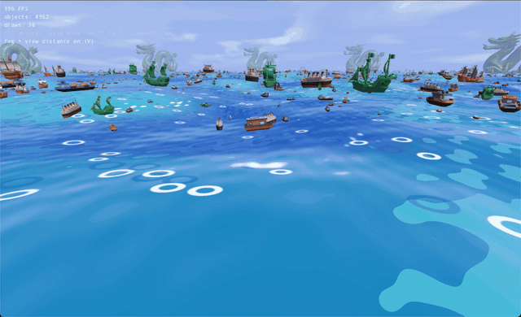
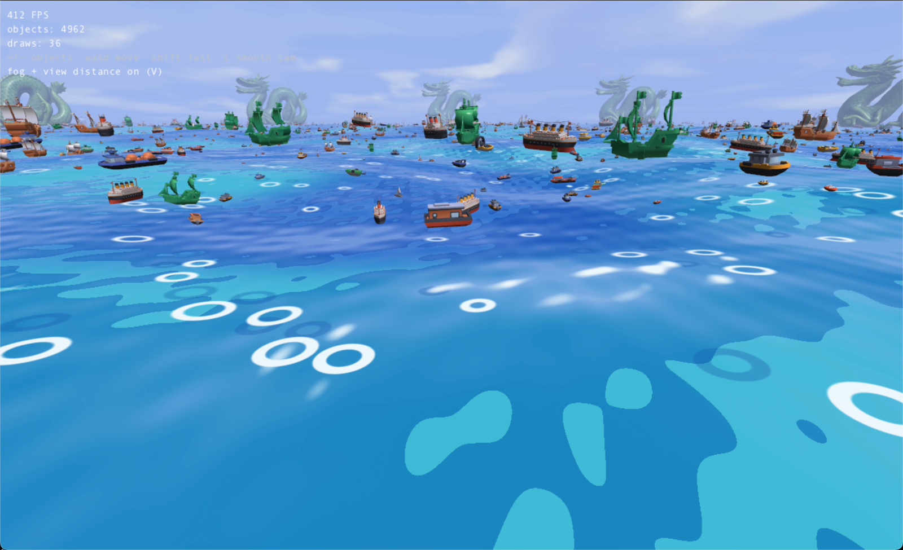
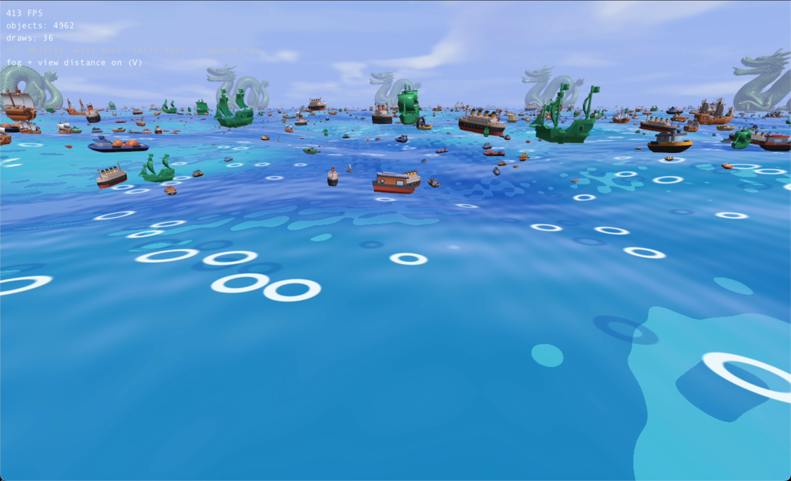

# Cubes

Demo of the `gbbfx` renderer (Odin + SDL3 GPU + Slang) with ten scenes, plus an
actor x Props `engine` layer on top.



| | |
|---|---|
|  |  |

The sea is the `benchmark` scene (`./main benchmark`): a displaced wave mesh, skybox,
distance fog and ~5000 instanced models in 36 draw calls (about 400 FPS windowed in the
capture above).

## Requirements

- [Odin](https://odin-lang.org) on `PATH` (or `ODIN=/path/to/odin make ...`).
- The `goose` submodule: `git submodule update --init`.
- `slangc`: the vendored one in `third_party/goose/vendor/slang/bin` (macOS arm64),
  or `SLANG=/path/to/slangc make ...` elsewhere.

## Build and run

```
make build                     # release binary ./main
make run ARGS=skinned           # scenes: skinned, game, forest_naive, forest_instanced, benchmark (default), city; fullscreen by default
make run ARGS="benchmark --bench 10"  # run 10 s without input, print fps/draws/triangles/CPU stats, exit
make run ARGS="skinned --WINDOWED"     # windowed (goes through the compositor)
make editor                    # debug build with the microui editor overlay
make test                      # shader generation + all test packages
make dist                      # dist/: binary + static/ assets
```

Asset paths (`static/...`) are relative to the working directory. Run from the
repo root (the `make` targets do this) or from inside `dist/`.

## Controls

- `1`-`9`, `0`: switch to a scene group with a fade; `Q`/`E`: previous/next scene in the current group. Scenes are grouped by the `group` field in `SCENES` (`src/scene.odin`); a group opens on the scene it showed last. Scene names show at the top, the group and position at the top right.
- `F1`: stats panel; `P` logs it. `M`: toggle MSAA. `Esc`: quit.

## Scene files and transitions

A scene can be plain data: `src/scenes/<name>/scene.json` (name, camera with optional bloom,
actors with model, clip, position, rotation in degrees, scale; see
`src/engine/scene_def.odin`). An entry in `SCENES` with no `make` runs from its JSON alone.
Game code switches scenes with
`engine.change_scene("forest_instanced", .Fade, 0.6)` (`Cut`, `Fade`, `Fade_White`, `Wipe`);
the host runs the transition (`src/transition.odin`) and swaps when the screen is covered.

`engine.push_scene(name, policy)` runs a scene on top of the current one and `engine.pop_scene()`
returns to it (dev keys: Shift+number pushes with `.Keep`, Backspace pops). The policy says what
happens to the scene underneath: `.Keep` stays alive in memory, `.Disk` writes itself with
`Scene.suspend` to `.cache/scene_stack/` and is recreated + `Scene.resume`d on pop (data scenes
have both hooks), `.Discard` is destroyed and recreated from scratch.
A scene may set `Scene.load`, which runs on a job thread before `create` (CPU work only: parse,
decode; see the rules in `src/engine/jobs/jobs.odin`). The transition stays covered with a progress
bar (or `Config.loading_screen`) until it finishes; `engine.preload_scene(name)` starts it early.
Data scenes decode their models and textures in parallel this way.

## Forest scenes

Both are the same BotW-style toon meadow: a 1024x1024 m world of 64x64 chunks streamed as
the camera moves, grass at two LODs, wind and shading in a shader, two-tone fog, sun
lens flare. They differ in how trees, rocks and bushes are drawn (F1 shows the numbers):

- `./main forest_naive` (`src/scenes/forest_naive/`, `shaders/forest.slang`): everything
  of a chunk is baked into one world-space mesh, one draw per chunk mesh. Every tree
  is unique geometry. It also owns the terrain, grass and flare code both scenes use.
- `./main forest_instanced` (`src/scenes/forest_instanced/`, `shaders/forest_instanced.slang`):
  13 variant meshes (oak, pine, broadleaf, autumn, rocks, bushes) are uploaded once and
  every placed tree is an instance of one, so each variant is a single instanced draw.
  The renderer sorts by (pipeline, material) only, so each variant has its own material.

## City scene

`./main city` (`src/scenes/city/`, `shaders/city_*.slang`): a procedural night city, a 3072x2048 unit plot of
streets, skyscrapers, towers and cube buildings, with lamps, animated cars and a sky. Keys: `R` re-roll the city,
`G` dev view (streets), `B` bloom, `F` distance fog, `T` rain, `O` auto-orbit camera (for recording), `WASD` and mouse fly,
`F1` stats. Every texture (windows, sky, ground) is generated by compute shaders at startup; there are no art assets.
Build log, one commit and tag per step: `city-series.md`, tags from `git tag -l 'city-*'`. Based on Shamus Young's
"Procedural City" series (Twenty Sided, https://www.shamusyoung.com/twentysidedtale/?p=2940).

## Skeletal animation

Rigged glTF characters use the skinned path. `make run ARGS=skinned` (or
`./main skinned`) plays clip 0 of `static/models/rigged_cesiumman.glb`.
Source: `src/scenes/skinned/scene.odin`.

### Loading

```odin
pipeline := defaults.create_textured_skinned_pipeline(gfx)
sampler  := gbbfx.gfx_sampler_create(gfx, gbbfx.SAMPLER_TRILINEAR)

imported, ok := loader.model_import_skinned_from_gltf("static/models/rigged_cesiumman.glb")
if !ok do return false
defer loader.skinned_model_destroy(&imported)

model := gbbfx.skinned_model_create(gfx, &imported, pipeline) // moves the skin into model
gbbfx.model_upload_to_gpu(&model, &gfx.renderer.uploader)
defaults.bind_textured_skinned_material(&model.material, gbbfx.model_texture(&model), sampler)
```

`skinned_model_create` takes the skin, so `skinned_model_destroy` then frees
only the rest. Keep `model` at a stable address (e.g. in scene state): actors
hold pointers to its mesh, material and skin.

### Actors and playback

```odin
actor := gbbfx.scene_actor(&scene, handle)
gbbfx.actor_add_skinned_renderable(actor, &model.mesh, &model.material, &model.skin)
gbbfx.actor_play_clip(actor, "clip_0") // false if no such clip; current clip kept

// every frame, before rendering:
gbbfx.scene_tick_animations(&scene, dt)
gbbfx.gfx_render(gfx, &scene)
```

- The actor starts on clip 0 at time 0, or the rest pose if the skin has no clips.
- `actor_play_clip` restarts the clip only when it differs from the current one.
- Time wraps modulo the clip duration (looping).
- Clip names are the glTF animation names, or `clip_N` (N = animation index in the file) when unnamed. Both bundled assets are unnamed, so they expose `clip_0`.
- Each actor owns its pose; `actor_destroy` frees it.

### Limits

- 128 joints per skin (`loader.MAX_JOINTS`); import fails above that.
- 64 skinned instances per frame (`MAX_SKINNED_INSTANCES`); the renderer asserts above that.
- Only the first skin in the file is imported. Primitives on nodes using other skins are skipped with a warning; non-triangle primitives are skipped.
- Cubic-spline channels are skipped with a warning. Linear and step interpolation are sampled.
- Skinned actors are never frustum- or distance-culled (no bounds).
- Linear-blend skinning over up to 4 joints per vertex; weights are normalized at import.
- Normals are approximate: the blended skin matrix's upper 3x3 transforms them, not its inverse transpose. Exact for rotation and uniform scale; non-uniform joint scale can skew shading.

### Shader and assets

- Shader source: `src/gbbfx/defaults/shaders/textured_skinned.slang`. Regenerate
  the embedded shaders with `make default-shaders` (`make run`, `make test` and
  `make shaders` run it too).
- Models: `static/models/rigged_cesiumman.glb` and `rigged_riggedsimple.glb`.
  Both are CC-BY 4.0 (Cesium, via Khronos glTF-Sample-Assets). Sources and
  license are in `static/models/README-rigged.txt`; keep it with the files
  when redistributing (`make dist` copies `static/`).

## Lua scripting

Actors can run a LuaJIT behaviour: `engine.Script{path = "src/scenes/scriptdemo/spinner.lua"}`. See the `*.lua` files next to their scenes under `src/scenes/`
for examples. A module returns a table with optional `create(self, a)`, `tick(self, a, dt)`,
`fixed_tick`, `destroy` and `reload` hooks; `a:transform()` gives the live `Transform*`, `engine.input.down(name)`
and `engine.find` / `engine.spawn_model` are also available. `a:set_scale`, `a:add_box_collider`, `a:add_sphere_collider` and `a:set_name` write components; `engine.camera_look_at`, `engine.camera_set_fov`, `engine.set_fog`, `engine.clear_fog`, `engine.set_sun`, `engine.set_shadows`, `engine.hud_text` (optional sRGB colour), `engine.window_size()` and `engine.time()` (scene seconds) are available too (see `luajit-design.md` 4.4). Odin calls named hooks with `script_call`; `on_contact(self, a, other)` runs when a contact begins.

- Hot reload: scripts are polled every 250 ms and reload on save; a failed reload keeps the old module.
  `F5` reloads all scripts. A runtime error faults only that actor until its file changes.
- `CUBES_JIT_V=1` dumps LuaJIT's trace log (`jit.v`) to stderr at host creation.
- `make luajit` builds the vendored LuaJIT 2.1 static lib (`third_party/luajit`); `test-engine` depends on it.
- Scenes: `scriptdemo` (grid driven by `src/scenes/scriptdemo/spinner.lua`, per-actor ticks), `scriptdemo_batch`
  (`src/scenes/scriptdemo/spinner_batch.lua`, one Lua call per frame), `scriptdemo_odin` (Odin `register_type` baseline, no Lua),
  `scriptdemo_balls` (`src/scenes/scriptdemo/balls.lua`: dynamic spheres on a static ground, `on_contact` grows them).
- `CUBES_SCRIPT_N=<count>` sets the actor count (default 100). `CUBES_SCRIPT_NOMODEL=1` spawns without models
  so a bench measures script cost only, e.g. `make run ARGS="scriptdemo --bench 5"`.
- Design, API and measurements: [luajit-design.md](luajit-design.md).

## Scaffolding

```
make new-scene NAME=my_scene            # code scene: src/scenes/my_scene/scene.odin
make new-scene NAME=my_data DATA=1      # data-only scene: scene.json, no import
make new-actor NAME=bot SCENE=my_scene  # actor file + register/spawn wiring in the scene
```

Add `DRY=1` to print the plan without writing. Names are `[a-z][a-z0-9_]*`; existing files are never
overwritten. Registry edits in `src/scene.odin` go between the `// cubes:imports`, `// cubes:scenes`
and `// cubes:actors` markers: keep them. The tool is `tools/cubes/` (run from the repo root).

## Layout

- `src/` - app (`main.odin`, scene registry `scene.odin`), `scenekit/` (shared scene type and helpers), `scenes/<name>/scene.odin` (one folder per scene).
- `src/gbbfx/` - renderer, render passes/postfx (`rgraph.odin`), loader (glTF), and default shaders in `defaults/`.
- `src/engine/` - `World` of actors x Props, with a per-type create/tick/destroy registry (`register_type`) and `engine.run`. See `examples/hello_engine` and the `game` scene (`src/scenes/game/game_player.odin`, `game_enemy.odin`).
- `src/glove/` - input system.
- `static/` - models, textures, fonts, skybox.
- `third_party/goose/` - shader build tool and Slang.
