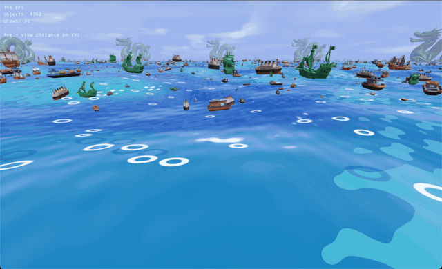
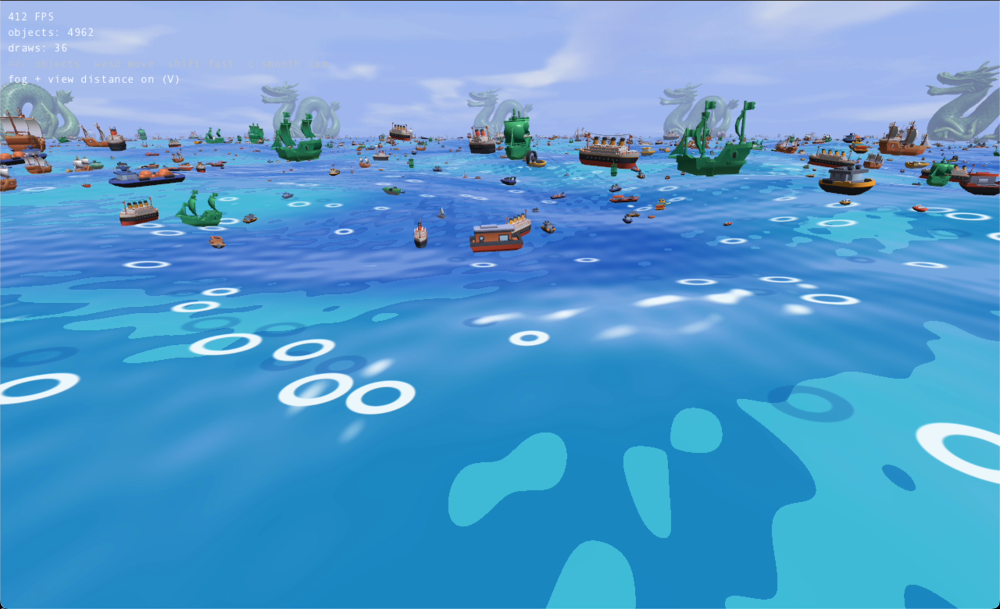
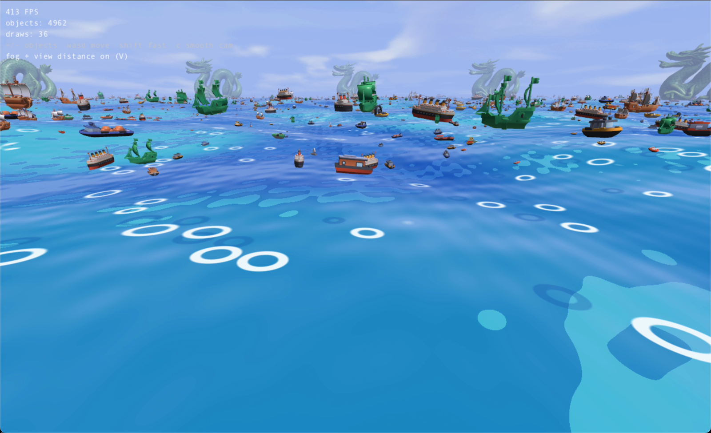

# Cubes

Demo of the `gbbfx` renderer (Odin + SDL3 GPU + Slang) with eight scenes, plus an
entity/component `engine` layer on top.



| | |
|---|---|
|  |  |

The sea is the `benchmark` scene (`./main benchmark`): a displaced wave mesh, skybox,
distance fog and ~5000 instanced models in 36 draw calls (about 400 FPS windowed in the
capture above).

## Requirements

- [Odin](https://odin-lang.org) on `PATH` (or `ODIN=/path/to/odin make ...`).
- The `goose` submodule: `git submodule update --init`.
- `slangc`: the vendored one in `third_party/goose/vendor/slang/bin` (macOS arm64),
  or `SLANG=/path/to/slangc make ...` elsewhere.

## Build and run

```
make build                     # release binary ./main
make run ARGS=models           # scenes: simple, editor, models, skinned, postfx, game, benchmark (default); fullscreen by default
make run ARGS="benchmark --bench 10"  # run 10 s without input, print fps/draws/triangles/CPU stats, exit
make run ARGS="models --WINDOWED"     # windowed (goes through the compositor)
make editor                    # debug build with the microui editor overlay
make test                      # shader generation + all test packages
make dist                      # dist/: binary + static/ assets
```

Asset paths (`static/...`) are relative to the working directory. Run from the
repo root (the `make` targets do this) or from inside `dist/`.

## Controls

- `1`-`8`: switch scene at runtime (order of `SCENES` in `src/scene.odin`).
- `M`: toggle MSAA.
- `Esc`: quit.

## Skeletal animation

Rigged glTF characters use the skinned path. `make run ARGS=skinned` (or
`./main skinned`) plays clip 0 of `static/models/rigged_cesiumman.glb`.
Source: `src/skinned_demo_scene.odin`.

### Loading

```odin
pipeline := defaults.create_textured_skinned_pipeline(gfx)
sampler  := gbbfx.gfx_sampler_create(gfx, gbbfx.SAMPLER_TRILINEAR)

imported, ok := loader.model_import_skinned_from_gltf("static/models/rigged_cesiumman.glb")
if !ok do return false
defer loader.skinned_model_destroy(&imported)

model := gbbfx.skinned_model_create(gfx, &imported, pipeline) // moves the skin into model
gbbfx.model_upload_to_gpu(&model, &gfx.renderer.uploader)
defaults.bind_textured_skinned_material(&model.material, gbbfx.model_texture(&model), sampler)
```

`skinned_model_create` takes the skin, so `skinned_model_destroy` then frees
only the rest. Keep `model` at a stable address (e.g. in scene state): entities
hold pointers to its mesh, material and skin.

### Entities and playback

```odin
entity := gbbfx.scene_entity(&scene, handle)
gbbfx.entity_add_skinned_renderable(entity, &model.mesh, &model.material, &model.skin)
gbbfx.entity_play_clip(entity, "clip_0") // false if no such clip; current clip kept

// every frame, before rendering:
gbbfx.scene_tick_animations(&scene, dt)
gbbfx.gfx_render(gfx, &scene)
```

- The entity starts on clip 0 at time 0, or the rest pose if the skin has no clips.
- `entity_play_clip` restarts the clip only when it differs from the current one.
- Time wraps modulo the clip duration (looping).
- Clip names are the glTF animation names, or `clip_N` (N = animation index in the file) when unnamed. Both bundled assets are unnamed, so they expose `clip_0`.
- Each entity owns its pose; `entity_destroy` frees it.

### Limits

- 128 joints per skin (`loader.MAX_JOINTS`); import fails above that.
- 64 skinned instances per frame (`MAX_SKINNED_INSTANCES`); the renderer asserts above that.
- Only the first skin in the file is imported. Primitives on nodes using other skins are skipped with a warning; non-triangle primitives are skipped.
- Cubic-spline channels are skipped with a warning. Linear and step interpolation are sampled.
- Skinned entities are never frustum- or distance-culled (no bounds).
- Linear-blend skinning over up to 4 joints per vertex; weights are normalized at import.
- Normals are approximate: the blended skin matrix's upper 3x3 transforms them, not its inverse transpose. Exact for rotation and uniform scale; non-uniform joint scale can skew shading.

### Shader and assets

- Shader source: `src/gbbfx/defaults/shaders/textured_skinned.slang`. Regenerate
  the embedded shaders with `make default-shaders` (`make run`, `make test` and
  `make shaders` run it too).
- Models: `static/models/rigged_cesiumman.glb` and `rigged_riggedsimple.glb`.
  Both are CC-BY 4.0 (Cesium, via Khronos glTF-Sample-Assets). Sources and
  license are in `static/models/README-rigged.txt`; keep it with the files
  when redistributing (`make dist` copies `static/`).

## Layout

- `src/` - app and scenes (`main.odin`, `*_scene.odin`).
- `src/gbbfx/` - renderer, render passes/postfx (`rgraph.odin`), loader (glTF), and default shaders in `defaults/`.
- `src/engine/` - `World` of entities x components, with a per-type create/tick/destroy registry (`entity_register`) and `engine.run`. See `examples/hello_engine` and the `game` scene (`game_player.odin`, `game_enemy.odin`).
- `src/glove/` - input system.
- `static/` - models, textures, fonts, skybox.
- `third_party/goose/` - shader build tool and Slang.
