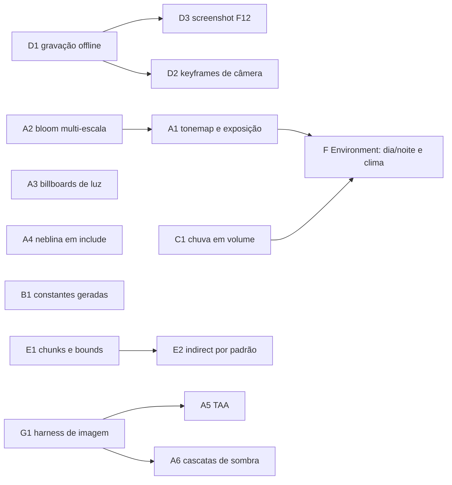

# Próximos passos da engine

Escopo: tudo que apareceu na sessão da cena `city` (passos 1-17) e que deveria morar na engine, mais ferramentas para os vídeos,
desempenho, visual e infraestrutura. Substitui `plan.md`, cujos itens P1-P8 já foram entregues (ver Fatos, último item).

Convenções (as mesmas do `plan.md`): toda tarefa termina com `make test-engine` verde e um smoke run do caminho alterado; teste novo só
para bug plausível de consumidor; uma tarefa = um commit; nada de shim, migrar todos os chamadores. Medidas de desempenho só em máquina
ociosa (`uptime` load < 2).

## Fatos verificados (2026-11-25, não suposições)

- Tonemap, exposição e color grading: **não existem**. `grep -w tonemap|exposure|reinhard|ACES` em `src/` e `shaders/` volta vazio. Só há bloom e blur em `src/engine/gfx/postfx.odin`.
- Bloom da engine: um nível só (half-res, blur gaussiano). O multi-escala com black floor vive em `src/scenes/city/bloom.odin` + `shaders/city_bloom_*.slang`.
- Áudio: **não existe**. Nenhum código em `src/` e nenhuma dependência em `third_party/` (só `goose` e `luajit`).
- GPU: o binding SDL3 GPU em `vendor/sdl3/sdl3_gpu.odin` só expõe fences (`QueryGPUFence`, `WaitForGPUFences`). **Sem timestamp queries**, então tempo por passe de GPU não é possível; só tempo total de GPU por frame via fence.
- Testes: `src/engine/gfx/sdl_gpu/sdl_gpu_test.odin` só testa o mapeamento de formato de shader. **Não há harness que renderize e compare imagem.**
- Sombras: um sol, um mapa `SHADOW_MAP_SIZE 2048` cobrindo `SHADOW_EXTENT 120` unidades (`renderer.odin:22-23`). Sem cascatas.
- Culling: existe frustum culling por esfera (`renderer.odin:391-411`), mas só para mesh com `radius > 0`. A malha da cidade (1,5 M de vértices, um draw) não tem bounds, então nunca é descartada.
- Indirect draws: existe como flag global `indirect_draws` (`renderer.odin:16`, `./main --indirect`), com doc em `docs/features/06-indirect-draws.md`.
- Constantes duplicadas à mão: `CITY_W`/`CITY_D` em `plan.odin` e em `city_ground_gen.slang`/`city_cars.slang`; `TILE_COUNT_SIDE` em `window_texture.odin` e `city.slang`. Já causou erro de manutenção.
- Código repetido por shader: billboards de luz em `lights.odin`, `cars.odin`, `beacons.odin`; neblina em `sea.slang` (por vértice), `city.slang` e `city_ground.slang` (por pixel).
- `plan.md` P1-P8 entregues: commits `fddd44c` (CLI de scaffolding), `d062077` (Lua por mundo e contatos), `6d4aa82` (`Scene_File_Status`, collider e environment em JSON), `154e6c4` (benchmark Lua).

## Ordem e dependências

Ondas sugeridas (é opinião, não estimativa de esforço):
1. **Vídeo e brilho:** D1, D3, A1, D2.
2. **Dedupe da cena city na engine:** A2, A3, A4, B1.
3. **Mundo vivo:** C1, C2, F.
4. **Desempenho e qualidade:** E1, E3, G1, depois E2.
5. **Visual avançado:** A5, A6, A7, G3.
6. **Bloqueado por hardware:** G2.

## A. Renderização e pós-processamento

### A1 Tonemap, exposição e color grading (primeiro item)

Problema: cada pedido de "mais escuro/mais claro" mexeu em 5 lugares (bloom, neblina, chão, curva em `city.slang`, constantes de cena).

- A1.1 Passe `Tonemap` no fim da cadeia `.Post` (compute, pattern `bloom_pass`): entrada HDR de `scene_color`, uniforms `exposure` (EV), `contrast`, `saturation`, curva `ACES` ou `AgX` aproximada; saída para o swapchain. Hoje o swapchain é `SDR_LINEAR` sRGB (`gfx.odin`): o passe escreve linear.
- A1.2 `Environment` ganha `exposure: Maybe(f32)` e `grade: Maybe(Grade)`; `world_update` aplica (como já faz com fog e sol). Campos também no JSON (`Environment` em `scene_def.odin`).
- A1.3 Migrar a cena `city`: tirar a curva noturna de `city.slang` e o `black floor` do composite quando o grade cobrir; ajustar com um único `exposure`. Tecla de dev (`[`/`]`) muda exposição ao vivo.
- A1.4 Teste: curva monotônica e `exposure = 0` é identidade (função pura em CPU espelhando o shader, ou teste de imagem do G1).

Pronto quando: escurecer ou clarear a cidade inteira é mudar um número; as outras cenas (forest, sea) ficam visualmente iguais com tonemap desligado (`Maybe` vazio = passe ausente).

### A2 Bloom multi-escala na engine

- A2.1 `Bloom` (`postfx.odin`) ganha `levels: int` (1 = comportamento atual, 3 = half/quarter/eighth), `weights`, `floor` (black floor). Portar `city_bloom_composite.slang` para `src/engine/gfx/shaders/`.
- A2.2 `city` passa a usar o bloom da engine e apaga `bloom.odin` e os `city_bloom_*`.

Pronto quando: `city` renderiza igual (comparar prints antes/depois) com o código de bloom só na engine.

### A3 Billboards de luz como pipeline da engine

- A3.1 `gfx.light_sprites`: pipeline aditivo, billboard voltado à câmera, tamanho mínimo em pixels, núcleo + halo, brilho animado opcional (`blink` fase/período). Entrada: buffer de posições/cores. Substitui `lights.odin`/`cars.odin`/`beacons.odin` shaders duplicados (os carros mantêm o vertex shader de animação: o include expõe a função de expansão do billboard).
- A3.2 Migrar os três usos.

Pronto quando: um único shader de sprite cobre postes, carros e beacons e os prints da cidade batem.

### A4 Neblina por pixel num include

- A4.0 Spike: confirmar que o `goose` passa o include path ao `slangc` (`import`/`#include` de `shaders/common/fog.slang`). [INFERÊNCIA: slangc suporta; goose não verificado.] Se não, o goose ganha um `includeDirs` no manifest.
- A4.1 `fog.slang` com `apply_fog(color, dist, fog)`; usar em `sea`, `forest*`, `city`, `city_ground`. Remove as cópias.

Pronto quando: `grep "0.6 \* " shaders/` mostra uma única definição da rampa.

### A5 TAA (depende de G1)

Jitter de projeção, histórico, reprojeção por velocidade de câmera (sem motion vectors por objeto no início: câmera estática vs movimento só da câmera), clamp de vizinhança. Alvo: shimmer em movimento que os mips e o MSAA não pegaram. Liga/desliga com tecla; medir custo.

### A6 Sombras: cascatas e múltiplos sóis (depende de G1)

2-3 cascatas (hoje 1 mapa de 2048 sobre 120 unidades) e `Environment.sun_direction` virando lista. Só vale para cenas que usam sombra (forest, boat); a `city` é sem sombra.

### A7 Visual extra (cada um é um spike separado, prioridade baixa)

- Reflexo/refração na água (`sea`).
- Névoa volumétrica / god rays (passe de pós com march curto no depth).
- Profundidade de campo (circle of confusion pelo depth).

## B. Dados e build

### B1 Constantes compartilhadas Odin <-> Slang

- B1.1 Um arquivo `shaders/constants.json` (ou campo no `goose.json`): `{ "CITY_W": 3072, ... }`; o `goose` gera um `constants.slang` (`static const`) e um `constants.odin` no pacote. O build falha se o `.odin` e o `.slang` divergem.
- B1.2 Migrar `CITY_W`, `CITY_D`, `TILE_COUNT_SIDE`, `ATLAS_SIZE`, `SKY_W/H`.

Pronto quando: mudar o tamanho da cidade é editar um lugar; grep por `3072` e `2048` fora do JSON volta vazio.

## C. Partículas

### C1 Volume que acompanha a câmera, sem emissor

Problema: a chuva atual (`rain.odin`, 2 emissores) é ultrapassada com Shift (3600 u/s) porque as gotas ficam paradas no mundo.

- C1.1 `Emitter_Desc.wrap_box: Maybe(Vec3)`: modo "volume": cada partícula tem posição em coordenadas locais da caixa e o vertex shader faz `world = camera + wrap(pos_local - camera, box)` (módulo por eixo). Sem spawn, sem vida; a gravidade anima por tempo. Custo constante, nunca ultrapassado.
- C1.2 `city` troca os dois emissores por um `wrap_box`.

Pronto quando: voar a 3600 u/s mantém densidade de chuva constante em volta da câmera (print em movimento + contagem de gotas visíveis).

### C2 Colisão com o chão e respingos

- C2.1 `Emitter_Desc.floor_y: Maybe(f32)`: gotas que cruzam o plano reiniciam; opcional `splash` = mini emissor de rings no ponto (GPU, quando barato).
- C2.2 Heightfield opcional depois (telhados): fora do escopo até C1 estar pronto.

## D. Ferramentas de vídeo

### D1 Gravação offline por passo de tempo fixo

Problema: `record.sh` usa `screencapture` em tempo real; exige a janela visível e à frente, e perde frames em cena pesada (<60 fps).

- D1.1 `--render-video <out.mp4> --fps 60 --seconds N`: o host roda com `dt` fixo (1/fps), lê o swapchain/`scene_color` de volta a cada frame (staging buffer, `DownloadFromGPUTexture`) e escreve PNG/raw para um pipe do `ffmpeg`. Não depende da janela nem do relógio.
- D1.2 Resolução desacoplada da janela (render target próprio 1920x1080 ou 4K).
- D1.3 `scripts/record.sh` passa a usar isso (mantém o modo antigo como fallback).

Pronto quando: um clipe de 10 s sai com exatamente 600 frames, mesmo com a cena a 30 fps ao vivo, e o resultado é determinístico (mesmo seed = mesmos pixels, com tolerância de GPU).

### D2 Trajetórias de câmera por keyframes

- D2.1 `Camera_Path`: lista de poses (posição, alvo, tempo) com interpolação Catmull-Rom e easing por segmento; arquivo JSON `*.path.json`.
- D2.2 Tecla `P` grava a pose atual como keyframe; tecla `L` reproduz; `--record path.json` usa o caminho (substitui arco/fly, que viram atalhos que geram um path).

### D3 Screenshot por tecla

F12 salva PNG na pasta `shots/` (gitignored) usando o mesmo readback do D1.

## E. Desempenho

### E1 Chunks e bounds na cidade

- E1.1 Dividir a malha da cidade em chunks (ex.: 8x8 sobre 3072x2048) com `mesh.center/radius`; o culling existente descarta o que está fora. LOD simples: chunks longe só com a geometria sem clutter (opcional).
- E1.2 Medir: triângulos e fps com câmera baixa (hoje ~55 fps mínimo).

### E2 Indirect draws por padrão (depende de E1)

Se E1 mostrar ganho, tornar `indirect_draws` opção da cena em vez de flag global.

### E3 Tempo de GPU no F1

Como o SDL3 não expõe timestamps (Fatos): medir só o tempo total de GPU por frame (fence do frame N-2) e mostrar em `stats.odin` ao lado dos tempos de CPU. Por passe não é possível sem backend próprio; registrar como limitação.

## F. Ambiente completo: dia/noite e clima

Depende de A1 (exposição) e C1 (chuva).

- F1 `Environment.time_of_day` (0..24) controla sol, cor do céu (hoje o céu da city é compute procedural), exposição e fog.
- F2 `Environment.weather {rain: f32, lightning: f32}`: chuva em C1; relâmpago = flash de exposição + luz direcional breve.
- F3 JSON do Environment (já existe `environment` desde `6d4aa82`) ganha os campos.

## G. Qualidade e infraestrutura

### G1 Harness de imagem com GPU

- G1.1 `make test-gpu`: renderiza cenas pequenas (cubo texturizado, bloom, skybox) para um render target offscreen e compara com PNG de referência em `tests/golden/` (tolerância por canal e % de pixels). Cria a janela escondida (`SDL_WINDOW_HIDDEN`) ou usa só render target.
- G1.2 Atualizar referências com `make test-gpu UPDATE=1`.
- G1.3 Pega regressões como os tons de janela (passos 14-15) e a troca de skybox.

### G2 Windows e Linux (bloqueado)

Sem hardware nesta máquina: `luajit` com `/MD` e o script `.bat` ficaram sem verificação. Só retomar quando houver Windows/Linux x86_64 com GPU. Nada a fazer aqui.

### G3 Áudio

Não existe nada. Direção mais barata: SDL3 `AudioStream` (já vem com o `vendor:sdl3`, sem dependência nova) [INFERÊNCIA: confirmar o binding antes]. Escopo mínimo: carregar WAV/OGG, tocar um clipe, volume e pan 3D simples por posição do ator; sem mixer próprio.

## H. Pendências da cena city (antes de gravar o vídeo final)

- Clipes dos passos 15, 16 e 17 não foram gravados; os de 1-14 foram feitos antes de várias mudanças (ver `city-series.md`, local e gitignored).
- Faixa quente do horizonte termina numa borda dura contra o corte do chão (visível no passo 17).
- Mínimo de fps na câmera baixa (~55): resolve com E1 ou subir `CAR_GAP_MIN`.
- Posição dos beacons é aproximada (bbox do geometria); setbacks sem luzes por degrau.
- Edição local não commitada em `src/engine/default/model.odin` (troca do `SKYBOX_PATH`): decidir se vira commit ou descarte.
- README ainda cita `city-series.md`, que é local e gitignored.

## Riscos

- A1 muda a imagem final de todas as cenas se o passe ficar sempre ligado: por isso `Maybe` vazio = sem passe.
- D1 depende do readback do swapchain no Metal: `DownloadFromGPUTexture` precisa de `COLOR_TARGET`/`SAMPLER` na textura; usar `scene_color` e não o swapchain.
- A4 depende de como o `goose` chama o `slangc`; é o item mais incerto da onda 2.
- C1 muda o comportamento do `Particle_Emitter`: é um modo novo (`wrap_box`), não altera o existente.
- A5 sem motion vectors por objeto vai borrar carros; aceitar ou mascarar.
- G1 compara imagens entre GPUs diferentes: tolerância tem que ser por tela/máquina; as referências valem só para macOS arm64.
