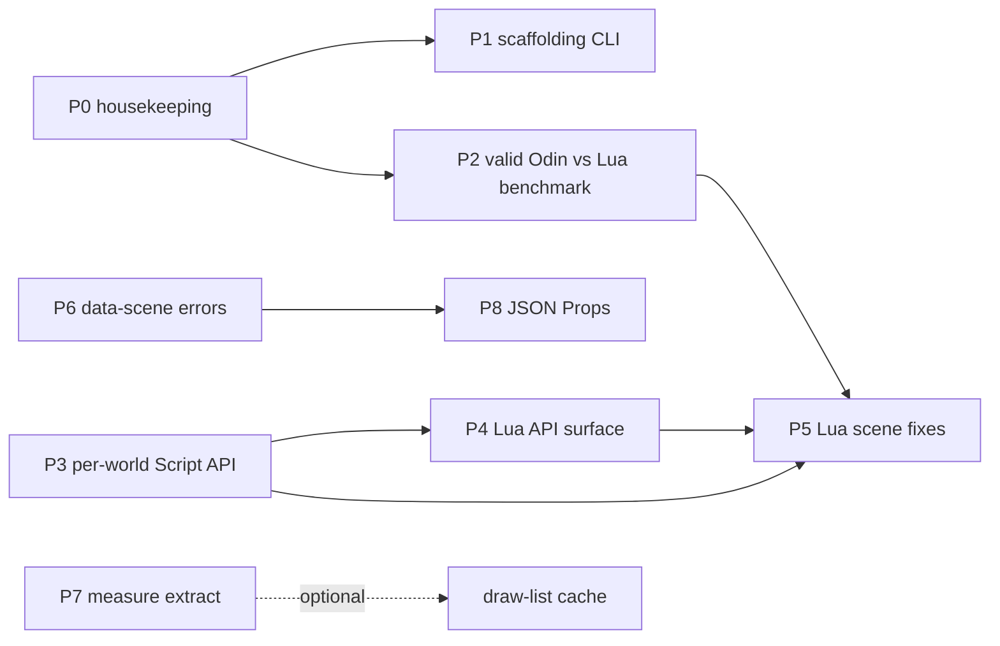

# Next steps: scaffolding CLI, usable Lua scripting, engine cleanup

Scope: roadmap items 1 (finish what is in flight), 2 (Lua usable for gameplay) and 3 (engine cleanup).
Item 4 (Windows, Linux x86_64 with GPU, macOS notarization) is blocked on hardware and not planned here.

Status of the previous plans: the LuaJIT scripting design (phases 0-5) and `improvements.md` (Actor/Props) are
implemented and committed. Both files were deleted from the working tree (uncommitted); the last committed versions are
`git show HEAD:plan.md` and `git show HEAD:improvements.md`. Three comments still point at the old plan.md
(`Makefile:14`, `README.md:154`, `src/engine/script_api.odin:11`): task 0.1 resolves that.

Facts this plan rests on (read from the code on 2026-11-24, not assumed):

- Scenes are registered in `src/scene.odin` (`SCENES` array + one import each). Per-actor convention is in `src/scenes/game/game_player.odin` (state struct + create/tick procs registered with `engine.register_type`).
- Lua API thunks use package globals `script_world`, `script_inputs`, `script_ctx`, `script_context` (`script_api.odin:33-43`): one scripted world at a time.
- `physics.odin` wraps `step`, `body_*`; it does not expose Box3D contact or sensor events, although the vendor package has `World_GetContactEvents`, `GetSensorEvents`, `ContactBeginTouchEvent`.
- `Actor_Def` (scene JSON) has model, clip, transform, sprite, health, particles. It has no collider and no environment.
- `world_extract` rebuilds the draw-pointer list every frame in `context.temp_allocator`. Its cost at ~5000 actors has never been measured.
- `scene_file_load` logs `cannot read` for a missing file; `data_load`/`data_create` call it for data scenes, where the file is mandatory.
- Lua constants for the benchmark boats are duplicated in Odin (`boat_step`) and Lua (`boat.lua`, `boat_batch.lua`); the Lua scenes use unseeded `math.random`; per-actor Lua sea time is per boat (`self.t`).

Global rules: every phase ends with `make test-engine` green and a smoke run of the changed path; no commit without the
user asking; Odin and Lua behaviour changes get a test that fails before and passes after.

## Order and dependencies

P1, P2, P3 and P6 are independent and can run in parallel. P4 needs P3 (new thunks take the host handle). P5 needs P2
(numbers) and P4 (time API). P8 needs P6 (clean missing/invalid distinction).

## P0 Housekeeping

- 0.1 Decide where the LuaJIT design lives. Recommended: restore it from `HEAD` as `luajit-design.md` at the repo root, and repoint the three references above. (`docs/` is gitignored, so it cannot live there.)
- 0.2 Note the untracked `src/scenes/city/` (not part of this work): P1's CLI must not clobber it; it is registered in `src/scene.odin` by hand today.

Done when: `grep -rn "plan.md" Makefile README.md src` points at files that exist.

## P1 Scaffolding CLI (item 1)

Goal: one command creates a scene (file with the main functions, registered) and one creates an actor (state + procs,
wired into a scene).

Design:

- Odin program `tools/cubes/main.odin`, run as `odin run tools/cubes -- <command>`; thin Makefile wrappers `make new-scene NAME=x` and `make new-actor NAME=y SCENE=x`. No dependency beyond `core:`.
- `new scene <name> [--data]`:
  - default (code scene) writes `src/scenes/<name>/scene.odin`: package `<name>`, `State` with a `world: engine.World`, `<name>_scene :: proc() -> engine.Scene`, `create` (world_create, camera_fly, one demo spawn), `tick` (world_update + world_render(&world, ctx.blend)), `destroy`. Pattern: `src/scenes/skinned/scene.odin`.
  - `--data` writes only `src/scenes/<name>/scene.json` (the registry already runs an entry without `make` from its JSON, see `scene_registry.odin:24`).
  - registers the scene in `src/scene.odin`: one import and one `SCENES` entry, inserted at marker comments `// cubes:imports` and `// cubes:scenes` (the CLI adds the markers on first use if missing).
- `new actor <name> --scene <scene>` writes `src/scenes/<scene>/<name>.odin`: `<Name>` state struct, `<name>_create`, `<name>_tick`, `<name>_destroy` with the engine signatures, header comment per the convention in `game_player.odin`; prints (and, with the marker `// cubes:actors`, inserts) the `engine.register_type` + `engine.spawn_typed` lines into the scene.
- Safety: names must match `[a-z][a-z0-9_]*` and not be Odin keywords or an existing package/scene; never overwrite an existing file; `--dry-run` prints what would change; on a registration failure nothing is left half-written (write files last, or roll back).

Tasks:

- 1.1 Template strings and name validation (pure procs, no IO).
- 1.2 Scene command: file generation + registration edit with markers.
- 1.3 Actor command: file generation + scene wiring.
- 1.4 Makefile targets and README section.
- 1.5 Tests (`tools/cubes/*_test.odin`): validation table; registration insert is idempotent and keeps order; a generated scene in a temp copy of `src/` passes `odin check`.

Done when: from a clean tree `make new-scene NAME=demo`, then `make new-actor NAME=bot SCENE=demo`, then `odin build src` succeeds; `/tmp/cubes_v demo --bench 2` runs and the actor ticks; `git status` shows only generated files plus the two registry lines. Undo with `git checkout src/scene.odin` plus deleting the generated directory.

Non-goals: Lua script generation, editor integration, templates for gfx-heavy scenes.

## P2 Valid Odin vs Lua benchmark (item 1)

Problem: the benchmark runs of 2026-11-24 were taken at load average 18-34; Odin `benchmark` averaged 25-167 ms per frame (max 3.5 s) against ~3.3 ms on a quiet machine. No conclusion is valid yet.

Tasks:

- 2.1 `make bench-script` target (or a script) that: refuses to run if `uptime` load average (1 min) is above 2, runs `benchmark`, `benchmark_lua`, `benchmark_lua_batch` interleaved, 3 runs each, at n=100, 150, 400, and prints a table of frame ms p50/p95 and script ms p50/p95.
- 2.2 Make the Lua scenes comparable first: complete P5.1 and P5.2 (seed and shared constants) so the three scenes run the same boats. Until then only per-boat cost (script ms) is comparable, not frame ms.
- 2.3 Record the table and the reading (where the time goes: script ms vs the frame delta) in `luajit-design.md` section 7. Mark any inference.

Done when: three consecutive runs of the same scene differ by less than 10% in frame ms p50, and the table is recorded with the load average at the time.

## P3 Per-world Script API (item 2)

Problem: the thunks read package globals, so a second scripted world (scene stack, tests) overwrites the first.

Design: every `Script_API` function takes the host handle as its first parameter (`rawptr`, the `^Script_Host`). `engine.lua` receives the handle once at load and captures it in its closures, so scripts do not see it. A scalar pointer argument stays traceable by LuaJIT (struct by value does not, see the measured section). Each thunk resolves `host.world`, `host.inputs`, `host.ctx`, `host.context` from the handle; the globals go away. `script_bind(world, inputs, ctx)` fills the host instead of the globals.

Tasks:

- 3.1 Move `script_world/inputs/ctx/context` into `Script_Host`; thunks take the host pointer first; update `Script_API`, `script_push_layout` and the ScriptAPI cdef.
- 3.2 `engine.lua`: capture the handle, keep the public `engine.*` signatures unchanged (scripts, `boat*.lua`, `spinner*.lua` untouched).
- 3.3 Remove `script_unbind` global state handling; `script_reload_all` reloads every live host (keep a small registry of hosts) or takes a world.
- 3.4 Test: two worlds alive at once, each with its own Script actors; scripts in each see only their own world (`engine.find` of a name that exists in one world only; input from two different `input.System`s).
- 3.5 Re-run `scriptdemo` bench: `script ms` must not regress by more than 5% (the extra argument is the only added cost).

Done when: the two-world test passes, no package-level `script_*` mutable globals remain in `script_api.odin`, `make test-engine` green, benchmark within 5%.

## P4 Lua API surface (item 2)

Principle: only scalars, pointers and out-params cross the FFI (struct by value aborts LuaJIT traces). No Lua tables on hot paths.

- 4.1 Collision events.
  - `physics.odin`: expose Box3D contact-begin and sensor-begin events after `step` (a slice of body-id pairs per step; no allocation beyond a reused buffer).
  - `World`: map `b3.BodyId` back to `Actor_Id` (Collider already stores the body in the slot); after `phys.step` in `world_update`, for each pair call a hook.
  - Odin side: `register_type` gains an optional `contact` proc (`world, id, self, other`), same transmute convention as `tick`.
  - Lua side: calls `module.on_contact(self, a, other)` if defined (resolved once at load like `tick`; no string lookup per event). Faulted rules unchanged.
  - Test: a falling Dynamic sphere on a Static ground in a `world_create(nil)` world: one contact-begin per touch, delivered to Odin hook and to a Lua `on_contact`.
- 4.2 Spawn with props from Lua without tables: `engine.spawn_model(path, x, y, z)` exists. Add thunks `actor_set_scale(i, g, sx, sy, sz)`, `actor_add_box_collider(i, g, hx, hy, hz, static)`, `actor_add_sphere_collider(i, g, r)`, `actor_set_name(i, g, name)`. Cdef, layout entries, tests.
- 4.3 Camera and environment control. `Camera` and `Environment` hold `Maybe(...)` fields, which have no stable C layout, so they are not exposed through `script_expose`. Provide scalar setters instead: `engine.camera_look_at(x, y, z)`, `engine.camera_set_fov(f)`, `engine.set_fog(r, g, b, distance)` / `engine.clear_fog()`, `engine.set_sun(x, y, z)`.
- 4.4 HUD helpers: `engine.hud_text` exists; add a colour variant and a window-size getter (`engine.window_size()` returning a reused `float[2]`, same convention as `camera_position`).
- 4.5 `engine.time()`: scene clock accumulated in `world_update` (`world.time`). Used by P5.3.
- 4.6 Docs: README Lua section lists the API; `luajit-design.md` section 4 updated.
- 4.7 Example: a small `src/scenes/scriptdemo` script using `on_contact` (balls that change behaviour on touch) to prove the end-to-end path.

Done when: each new thunk has a test (or a stated reason it cannot be tested without a GPU), the layout test passes, `CUBES_JIT_V=1` on the example shows no NYI/blacklist from `engine.lua`, `make test-engine` green.

## P5 Lua scene fixes (item 2)

- 5.1 Shared boat constants and initial state. Expose a `Boat` prop `{heading, speed: f32}` with `script_expose`; Odin `benchmark_populate` sets it for every boat (and the Odin path uses it too, replacing the `Boat_Slot` fields), so Odin and Lua scenes start identical and `math.random` disappears from the scripts.
- 5.2 Constants single source: Odin passes `FLEE_RADIUS`, `FLEE_TURN_RATE`, `SAIL_X_LIMIT`, `SAIL_Z_NEAR`, `SAIL_Z_FAR` once at scene create through a `script_set_config(world, name, value)` call exposed as `engine.config.<name>` (a plain Lua table read at script load, not per tick: copy into locals). Remove the duplicated Lua constants.
- 5.3 Sea phase: per-actor `self.t` replaced by `engine.time()` (P4.5); the Odin scene sets `sea_state.time = world.time` so mesh, Odin boats and Lua boats share one clock.
- 5.4 Test: Odin and Lua boat step produce the same position after N ticks for the same initial prop values (tolerance for float32 vs double).

Done when: `benchmark`, `benchmark_lua`, `benchmark_lua_batch` show visually matching fleets, boats added with `=` are in phase with the sea, and the parity test passes.

## P6 Data-scene error handling (item 3)

Problem: `scene_file_load` returns a bool; a missing mandatory file and an invalid file look the same, and the missing case logs `cannot read` without naming the scene.

- 6.1 `scene_file_load` returns an enum `{Ok, Missing, Invalid}` (callers: `data_load`, `data_create`, `data_reload`, `scene_registry`, tests).
- 6.2 Code scenes (registry): `Missing` is silent (already behaves that way via `os.exists`; use the enum instead). Data scenes: `Missing` logs one error `scene "<name>": definition file <path> not found`; `Invalid` keeps the parse error with file/line.
- 6.3 Tests: missing, invalid JSON, valid; `odin test` fails on `log.errorf`, so the quiet paths prove themselves and the error paths use `log.nil_logger()`.

Done when: running a data scene with its JSON renamed prints exactly one error naming the scene and the run fails cleanly; code scenes without JSON print nothing.

## P7 World extract cost (item 3, measure first)

Problem: `improvements.md` left a contingency (cache the draw-pointer list) with no measurement.

- 7.1 Measure with the stats row `cpu extract` at `benchmark` n=400 (about 12.8k actors) on an idle machine: report extract ms p50 and its share of frame ms p50.
- 7.2 Gate: implement the cache only if extract is above 5% of frame p50. Cache design: `World.draw_list: [dynamic]^gfx.Draw` rebuilt when `spawn`/`destroy`/`Model` add or remove sets a dirty flag; `Slot.draw` addresses must stay stable (slots reallocate on spawn, so rebuild after any growth).
- 7.3 If under the gate: record the number in `luajit-design.md`/`README` and close the item with no code change.

Done when: the decision and the measurement are recorded; if implemented, benchmark draw calls and instances are identical before and after (±0) and `cpu extract` drops.

## P8 JSON Props: Collider and Environment (item 3)

Problem: scene JSON cannot describe colliders or environment, so physics and sky/fog scenes need code.

- 8.1 `Actor_Def` gains `collider` (`shape: "box"|"sphere"`, `half` or `radius`, `body: "dynamic"|"static"`, `density`) and `environment` (`skybox`, `fog {color, distance}`, `shadows`, `sun_direction`, `uncapped`), as `Maybe(...)` with `omitempty`.
- 8.2 `world_apply_scene` / hot reload (`scene_apply.odin`): typed `sync_kind` for both Props (value equality needs content, as for the other builtins); `actor_to_def` and `world_save_scene` write them back (round trip test).
- 8.3 Out of scope and documented: `Raw_Draw` and user-registered custom Props stay code-only.
- 8.4 Demo: convert `src/scenes/physics` ground and `benchmark` environment to JSON only if it removes code without changing behaviour; otherwise leave the scenes alone and add a tiny data scene as the example.

Done when: a data scene with a collider and an environment loads, simulates (sphere rests on the ground) and survives hot reload and Ctrl+S round trip; `make test-engine` green.

## Risks

- P1 edits `src/scene.odin` by text insertion: a hand-edited file without the markers needs a first-run fallback; the CLI must refuse rather than guess when the structure is unrecognised.
- P3 changes every thunk signature: the layout test and a grep for `api.` calls in `engine.lua` are the safety net; scripts are unaffected because `engine.*` stays the same.
- P4.1 depends on Box3D event semantics (begin-touch only fires with `enableContactEvents` on the shape); [INFERENCE] until the first test confirms it.
- P7 may conclude "no change needed"; that is a valid outcome.
- Machine load: P2 and P7 numbers are only valid on an idle machine; the bench script enforces it.
