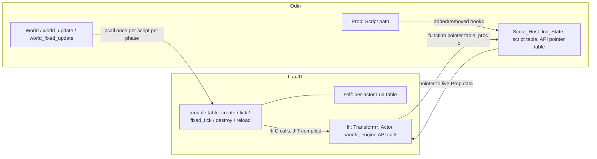

# LuaJIT scripting for the engine

Status: **phases 0-4 done on macOS arm64** (63 passing engine tests; benchmarks in section 7). Phase 0: submodule pinned at `96f7b297326e9fd454b7186c6858b2773f94a0dc`, `make luajit`, `src/engine/luajit` binding. Phase 1: `Script_Host`, `Script` prop, tick/fixed_tick, `script_call`, faulted handling. Phase 2: `script_api.odin`, embedded `engine.lua` with layout checks, `script_expose` / `a:prop`, `scriptdemo` scenes. Phase 3: hot reload (4 Hz mtime poll, `reload` hook, F5 key; F5 exercised on macOS: F5 in the F1 panel logs `script reloaded`). Phase 4: GC budget, `script` stats row, batch mode, `CUBES_JIT_V=1`, measured table. Phase 5 (Linux/Windows): Linux arm64 (ubuntu:24.04 container, Odin `dev-2026-11a` linux-arm64) passes `make luajit`, `odin check src -define:EDITOR=false` (script_*, engine.lua embed, luajit type-check), `odin check src/engine/luajit -no-entry-point`, `odin build src -build-mode:obj`, and a full link `odin build src` to an ELF (SDL3 built from source, release-3.4.20, since noble apt has no SDL3). Not run on Linux: `make default-shaders`, `make test-engine`, and executing the linked binary (goose's Slang is macOS arm64). Linux x86_64 and Windows not started. Replaces the abandoned PUC-Lua 5.4 experiment.

Phase 0 notes: The `LUAJIT=system` fallback is a Makefile no-op only; the Odin binding does not link a system lib yet. Linux arm64 verified in an ubuntu:24.04 container (Docker/colima): `make luajit` (GC64 flag passed, `libluajit.a` built) and `odin test src/engine/luajit` (6 tests pass) with the Linux link branch unchanged (`system:m`, `system:dl`, no fixes needed). Phase 5 smoke on the same container: `odin check src` and full link to an ELF pass with no Linux-specific edits to `script_*.odin`, `luajit.odin`, or the Makefile. Odin's vendor `cgltf`, `stb` and `box3d` need their `build_*.sh` scripts run first on Linux (box3d's script also needs `wasm-ld`, from `lld-18`); SDL3 comes from source. Linux x86_64 and Windows link branches are written but never compiled.

## 1. Goal and non-goals

Goal: optional gameplay scripting in **LuaJIT 2.1** with hot reload, layered **on top of** the existing Odin scripting
(`register_type`, `register_props`), not instead of it. Choosing between them is per feature:

| Use | When |
|---|---|
| Odin (`register_type` tick procs) | hot paths, 1k+ actors per type, systems code, anything touching GPU/physics/jobs |
| Lua (`Script` prop) | gameplay, tuning, prototyping, anything you want to edit while the scene runs |

Both coexist on one actor. Odin tick runs first, Lua tick second (section 6).

Non-goals (v1): Lua calling the renderer (`gfx.*`), Lua on job threads, a sandbox as a security boundary, a script
debugger, a file-system watcher thread (mtime polling is enough), a Lua-driven scene format.

## 2. Architecture



Two crossing mechanisms, chosen on cost:

1. **Odin to Lua**: classic `lua_pcall`, one call per (script, actor, phase). Pre-resolved with `luaL_ref`, no string lookups per frame.
2. **Lua to Odin**: **LuaJIT FFI**, not the `lua_CFunction` stack API. FFI calls to C function pointers are compiled into the trace; a `lua_CFunction` goes through the Lua stack on every call. (Orders of magnitude from LuaJIT documentation and experience, not measured here: phase 4 measures it on this engine.) Data (Transform etc.) is read and written **in place** through `ffi` pointers, with no copies.

New code layout:

```
third_party/luajit/            git submodule, pinned commit of LuaJIT v2.1
src/engine/luajit/             minimal Odin binding of the Lua 5.1 C API + luajit.h (state, pcall, ref, loadfile, openlibs)
src/engine/script_host.odin    lua_State lifecycle, load/reload, error handling, GC budget
src/engine/script_api.odin     the C-ABI function table handed to Lua (proc "c")
src/engine/script_types.odin   Script prop, Lua-visible struct layouts + size checks
src/engine/script/engine.lua   ffi.cdef + metatypes, the `engine` module (embedded with #load)
scripts/                       user scripts (demo: scripts/spinner.lua)
```

`luajit` is a leaf package (no engine imports). Everything that needs `World` lives in package `engine`, because
`World` must call the host and the host must call `World` (avoids an import cycle).

## 3. Odin to Lua interface

### 3.1 Script prop

```odin
// Prop: attaches a Lua behaviour. path is borrowed (must outlive the actor), like Model.path.
Script :: struct {
	path: string,
}
```

`Script` is registered in `world_create` through `register_props` like every builtin:

- `added`: ensure the host exists (lazy, first Script creates the `lua_State`), load or reuse the module for `path`, create the per-actor `self` table (stored in the registry via `luaL_ref`, kept on the slot), call `module.create(self, actor)`.
- `removed`: call `module.destroy(self, actor)`, `luaL_unref`.

### 3.2 Tick and fixed tick: thin wrappers

The user-facing contract: **`tick` and `fixed_tick` are just wrappers over a Lua call.**

```odin
// Registered once; every Script actor gets these. No logic of its own.
script_tick       :: proc(world: ^World, id: Actor_Id, dt: f32) { script_call(world, id, .Tick, dt) }
script_fixed_tick :: proc(world: ^World, id: Actor_Id, dt: f32) { script_call(world, id, .Fixed_Tick, dt) }
```

- `world_update(world, dt)` runs `script_tick` after the Odin actor ticks, before the physics step.
- New `world_fixed_update(world, dt)` runs Odin `fixed_tick` procs and then `script_fixed_tick`. Scenes call it from `Scene.fixed_tick` (the hook already exists, `Config.fixed_hz`).
- `register_type` gains an optional trailing `fixed_tick` parameter (default nil, source compatible).
- Caveat that already exists today: some scenes set `fixed_tick = world_update` (physics). Those get Lua `tick` at the fixed rate and must not also call `world_fixed_update`. Documented in `world.odin`.

### 3.3 Calling Lua from Odin by name

For events (collisions, damage, UI) Odin calls a named function in the actor's module:

```odin
script_call(world, id, "on_hit", damage)      // variadic any: f32, i32, bool, string, Actor_Id
```

Missing function is a no-op (returns false). Arguments are pushed with `lua_pushnumber` etc.; no allocation for scalars.

### 3.4 Batch mode (the performance escape hatch)

Per-actor `pcall` has a fixed cost per call (stack setup, error frame); estimated at a few hundred ns to ~1 us, to be measured in phase 4. At 1000 scripted actors that is on the order of 0.5 ms of pure call overhead. For large
populations a script can be declared **batch**: one call per frame, Lua iterates the actors inside a JIT-compiled loop.

```lua
M.batch = true
function M.tick_all(ids, count, dt)     -- ids: Actor[count] cdata, contiguous
  for i = 0, count - 1 do
    local t = ids[i]:transform()
    t.position.y = t.position.y + dt
  end
end
```

Guideline (measured, section 7 "Measured on this machine"): before the FFI fix, per-actor was cheaper than batch at 5000 and 50000 actors (batch JIT aborted on the struct-by-value `actor_transform`). After the fix (Actor thunks take `u32` index/generation), both modes compile and are close: at 50000 per-actor 3.2 ms vs batch 3.7 ms script time. **Decision: per-actor is the default; batch stays an opt-in with no measured win for this body** (revisit if a script keeps cross-actor state in flat arrays). Odin remains about 5x cheaper than per-actor Lua at 50000 (frame-level number from before the change).

Implementation: `tick_all` / `fixed_tick_all` are called once per frame from `script_update`, after the per-actor pass. `ids` is a contiguous `Actor_Id` buffer in the temp allocator, wrapped by engine.lua's `_batch` (cdata cast cached by address). A Lua error faults every actor of that module until reload; other modules keep running. `CUBES_JIT_V=1` turns on LuaJIT's `jit.v` trace dump (stderr) at host creation.

## 4. Lua to Odin interface

### 4.1 How the API is exposed (cross-platform safe)

Odin does **not** export symbols for `ffi.C` lookup: exporting from an executable differs on Windows (`dllexport`),
macOS and Linux (`-rdynamic`). Instead Odin builds one table of `proc "c"` function pointers and passes it at init:

```odin
Script_API :: struct {
	version:         u32,
	actor_valid:     proc "c" (index, generation: u32) -> bool,
	actor_transform: proc "c" (index, generation: u32) -> ^Transform,
	actor_destroy:   proc "c" (index, generation: u32),
	actor_find:      proc "c" (name: cstring, out: ^Actor_Id),
	actor_prop:      proc "c" (index, generation: u32, name: cstring) -> rawptr, // Prop pointer by exposed name; nil if absent
	spawn_model:     proc "c" (path: cstring, x, y, z: f32, out: ^Actor_Id),
	input_button:    proc "c" (name: cstring) -> i32,
	input_down:      proc "c" (action: i32) -> bool,
	input_pressed:   proc "c" (action: i32) -> bool,
	mouse:           proc "c" (out: ^[2]f32),
	hud_text:        proc "c" (text: cstring, x, y: f32),
	log:             proc "c" (level: i32, msg: cstring), // 0 debug, 1 info, 2 warn, else error
}
```

`script_api.odin` stores `^World` and `^input.System` in package-level variables bound by `script_bind(world, inputs: ^input.System)`;
the thunks read them. One world per host in v1 (stated limit).

Why index/generation and out-params: LuaJIT's trace recorder (`lj_crecord.c` `rec_ccall`) compiles C calls only when args and return are number, pointer or enum. A struct passed or returned by value aborted the trace (`NYI: unsupported C function type`), so every thunk takes `(index, generation: u32)` and struct results go through `out: ^Actor_Id`. `input_button(name)` returns the action index (-1 if unknown; engine.lua caches it); `input_down` / `input_pressed` take that index. The Lua `Actor` metatype wraps the pair again, so scripts still see a struct.

### 4.2 Lua side

```lua
-- engine.lua (embedded). One cdef, one metatype, zero table allocations in hot paths.
local ffi = require("ffi")
local api_ptr, layout = ...
ffi.cdef[[
typedef struct { float x, y, z; } Vec3;
typedef struct { float x, y, z, w; } Quat;
typedef struct { Vec3 position; Quat rotation; Vec3 scale; } Transform;
typedef struct { uint32_t index, generation; } Actor;
typedef struct {
  uint32_t version;
  bool (*actor_valid)(uint32_t index, uint32_t generation);
  Transform *(*actor_transform)(uint32_t index, uint32_t generation);
  void (*actor_destroy)(uint32_t index, uint32_t generation);
  void (*actor_find)(const char *name, Actor *out);
  void *(*actor_prop)(uint32_t index, uint32_t generation, const char *name);
  void (*spawn_model)(const char *path, float x, float y, float z, Actor *out);
  int32_t (*input_button)(const char *name);
  bool (*input_down)(int32_t action);
  bool (*input_pressed)(int32_t action);
  void (*mouse)(float *out);
  void (*hud_text)(const char *text, float x, float y);
  void (*log)(int32_t level, const char *msg);
} ScriptAPI;
]]
local api = ffi.cast("ScriptAPI*", api_ptr)

-- Typed pointer type per exposed name, cast once.
local prop_types = {}
ffi.metatype("Actor", {
  __index = {
    valid = function(a) return api.actor_valid(a.index, a.generation) end,
    transform = function(a) return api.actor_transform(a.index, a.generation) end,
    destroy = function(a) api.actor_destroy(a.index, a.generation) end,
    prop = function(a, name)
      local p = api.actor_prop(a.index, a.generation, name)
      if p == nil then return nil end
      local t = prop_types[name]
      if t == nil then
        t = ffi.typeof(name .. "*")
        prop_types[name] = t
      end
      return ffi.cast(t, p)
    end,
  },
})
```

Layout safety: for every struct shared with Odin, Odin passes `size_of`/`offset_of` values at init; Lua asserts
`ffi.sizeof(...)` and `ffi.offsetof(...)` match and aborts script loading with a clear error otherwise. Same
pattern as the `#assert(size_of(...))` already used for shader parameter structs.

### 4.3 Exposing your own Props to Lua

```odin
Health :: struct { hp, max_hp: f32 }
register_props(&world, Health)
script_expose(&world, Health, "Health", "typedef struct { float hp, max_hp; } Health;")
```

```lua
local h = a:prop("Health")          -- Health* or nil; live pointer, valid until the prop is removed
h.hp = h.hp - 10
```

`script_expose` records `size_of(T)` and the cdef text; the size check above runs on it. Props are heap blocks with
stable addresses until removed (see `Prop_Block`), so a pointer fetched this frame is valid for the whole call.
Never cache one across frames.

## 5. Example: end to end

**Odin (scene):**

```odin
spinner_create :: proc(demo: ^engine.Scene, ctx: ^engine.Context) -> bool {
	state := new(State); demo.state = state
	state.world = engine.world_create(&ctx.gfx)
	engine.script_bind(&state.world, &ctx.input)             // binds input + world for the API table
	engine.spawn(&state.world,
		engine.Model{path = "static/models/ship.glb"},
		engine.Script{path = "scripts/spinner.lua"})
	return true
}
spinner_tick       :: proc(demo: ^engine.Scene, ctx: ^engine.Context, dt: f32) { /* world_update + world_render */ }
spinner_fixed_tick :: proc(demo: ^engine.Scene, ctx: ^engine.Context, dt: f32) { engine.world_fixed_update(&state.world, dt) }
```

**Lua (`scripts/spinner.lua`):**

```lua
local engine = require("engine")
local M = {}

function M.create(self, a)
  self.speed = 1.5
  self.t = 0
end

function M.tick(self, a, dt)                    -- every frame
  local t = a:transform()
  t.position.y = 1 + math.sin(self.t) * 0.25
  self.t = self.t + dt
  if engine.input.down("W") then t.position.z = t.position.z - 5 * dt end
end

function M.fixed_tick(self, a, dt)              -- fixed rate (physics-adjacent logic)
  -- deterministic stepping here
end

function M.on_hit(self, a, damage)              -- called from Odin: script_call(world, id, "on_hit", 10.0)
  local h = a:prop("Health")
  if h then h.hp = h.hp - damage; if h.hp <= 0 then a:destroy() end end
end

function M.reload(self, a)                      -- optional, after hot reload; self is preserved
  self.speed = 1.5
end

return M
```

**Odin extending an existing Lua actor** (Odin scripting stays on top):

```odin
Ship :: struct { fuel: f32 }
ship := engine.register_type(&world, Ship, nil, ship_tick, nil)
engine.spawn_typed(&world, ship, Ship{fuel = 100},
	engine.Model{path = "static/models/ship.glb"},
	engine.Script{path = "scripts/spinner.lua"})     // same actor: ship_tick runs, then spinner.lua tick
```

## 6. Execution order per frame

1. `script_host_poll_reload` (mtime check, throttled to 4 Hz, runs before any script).
2. `world_update`: Odin actor ticks (slot order) -> Lua `tick` (slot order) -> physics step -> transform sync -> animation, camera.
3. `world_fixed_update` (0..N times, when the scene calls it): Odin `fixed_tick` -> Lua `fixed_tick`.
4. GC budget step (section 7.4).

Within a phase, Lua ticks run in slot order, like Odin ticks. Spawning from Lua mid-tick is allowed; new actors
follow the existing `born` rule (they start ticking next frame).

## 7. Performance considerations

1. **Crossing cost dominates, not Lua speed.** Hot loops stay inside Lua (JIT) or inside Odin; avoid ping-pong. FFI function-pointer calls are trace-compiled; `lua_CFunction` calls are not.
2. **Zero allocation in tick.** No tables, closures, strings or varargs created per frame; use ffi cdata, reuse locals. Allocation makes GC work and aborts traces.
3. **No string lookups per frame.** Function refs via `luaL_ref`; input action names are interned once (`input.down("W")` converts to a cached action id after first use).
4. **GC budget.** LuaJIT 2.1 has an incremental collector only (no generational mode). The host stops automatic GC after setup and runs `lua_gc(LUA_GCSTEP, n)` once per frame with a configurable budget (default ~0.2 ms); `lua_gc(LUA_GCCOLLECT)` on scene switch.
5. **Trace friendliness.** Avoid NYI features in hot loops (`pairs` over big tables, string building, `unpack`, FFI callbacks). A debug flag enables `jit.v`/`jit.dump` output so authors can see aborts.
6. **Batch mode** (3.4) for large populations.
7. **Pointer fetch cost.** `a:transform()` is one FFI call to a small thunk (index check + pointer). Cache within a tick, never across frames.
8. **Reload does not thrash JIT.** Reload swaps the module table; old traces die with their functions. `jit.flush()` is called only when a reload actually changed a file.
9. **Budget visibility.** The existing stats overlay gets a `script` timing row (tick, fixed_tick, gc), next to `cpu extract` and `cpu prepare`, so a regression is visible immediately. Current baseline for comparison: CPU extract 0.17 ms, prepare 0.44 ms, frame 3.31 ms on `benchmark`.
10. **Single state, main thread only.** `lua_State` is not thread-safe. Scripts never run from the job pool. Per-worker states for parallel scripts are out of scope.

### Measured on this machine (macOS arm64 M-series)

Commands, from repo root, after `make default-shaders shaders luajit && odin build src -out:/tmp/cubes_v`:

`CUBES_SCRIPT_NOMODEL=1 CUBES_SCRIPT_N=<N> /tmp/cubes_v <scene> --bench 5`

`CUBES_SCRIPT_NOMODEL=1` spawns actors without `Model` (no draw calls), so the numbers are script and world cost. Each config run twice; both runs shown. Windowed, msaa 4x, 4 s warmup + 5 s sampled. `script ms` = `script_take_frame_ms` per frame (tick + fixed_tick + gc). Odin baseline has no Lua host, so only frame ms.

| Scene | N | script ms avg / p95, after (run 1, run 2) | script ms avg / p95, before (run 1, run 2) |
|---|---|---|---|
| scriptdemo (per-actor) | 100 | 0.058 / 0.109, 0.017 / 0.021 | 0.186 / 0.356, 0.215 / 0.363 |
| scriptdemo (per-actor) | 1000 | 0.260 / 0.357, 0.256 / 0.346 | 0.731 / 0.854, 0.733 / 0.911 |
| scriptdemo (per-actor) | 5000 | 0.432 / 0.476, 0.437 / 0.483 | 2.456 / 2.621, 2.424 / 2.591 |
| scriptdemo (per-actor) | 50000 | 3.191 / 3.490, 3.177 / 3.509 | 30.362 / 32.530, 30.302 / 32.712 |
| scriptdemo_batch | 100 | 0.028 / 0.082, 0.045 / 0.111 | not measured |
| scriptdemo_batch | 1000 | 0.271 / 0.374, 0.229 / 0.350 | not measured |
| scriptdemo_batch | 5000 | 0.422 / 0.504, 0.419 / 0.485 | 2.640 / 2.861, 2.617 / 2.803 |
| scriptdemo_batch | 50000 | 3.753 / 4.202, 3.637 / 4.161 | 34.825 / 37.496, 34.993 / 37.324 |
| scriptdemo_batch, after batch-id merge (no second slot scan) | 50000 | 3.108 / 3.445, 3.248 / 3.596, 3.411 / 4.257 (3 runs) | 3.692 / 4.364, 3.874 / 4.460 (pre-merge, 2 runs) |
| scriptdemo (per-actor), after batch-id merge, same build | 50000 | 3.198 / 3.500, 3.268 / 3.617, 3.281 / 3.587 (3 runs) | 3.204 / 3.623, 3.212 / 3.590 (2 runs) |

Odin baseline (no Lua host), frame ms, before the change: 1.68 at N=100/1000/5000, 6.2 at 50000. Frame ms not re-captured after the change; script ms is the number that moved.

Findings:
- Root cause: `Actor` (8-byte struct) passed by value across the FFI. LuaJIT's recorder (`lj_crecord.c` `rec_ccall`) accepts only number/pointer/enum args and returns, so every `a:transform()` aborted the trace with `NYI: unsupported C function type` and the loop was blacklisted. All of tick_all ran interpreted.
- Fix (API side): Script_API thunks take `(index, generation: u32)`. Struct returns (`actor_find`, `spawn_model`) became out-params (`^Actor_Id`). The `Actor` cdef stays for users; metatype methods unpack `a.index, a.generation`. Layout check and `script_api_engine_layout_matches_odin` still pass.
- Verified with `CUBES_JIT_V=1`, N=5000: `spinner_batch.lua:17 loop` gets a root trace with a side trace, no `blacklist`. Per-actor `spinner.lua` loop also compiles, no `blacklist`.
- Fixed: `M.find` / `M.spawn_model` reuse one module-level `out_actor` and return a copy only when found; a scratch 3000-iteration `engine.find` hot loop (test deleted) compiles with no NYI.
- Fixed: batch gap. Cause: `script_batch_tick` did a second full slot scan (`slot_component` per slot, about 0.8 ms at 50000) to build the ids buffer, on top of the scan `script_update` already does. Fix: `script_update` appends batch ids to `Script_Module.ids` in its existing pass; `script_batch_tick` re-checks them (alive, generation, module, faulted) only when a per-actor hook or an earlier batch call ran. Batch now 3.26 ms avg vs per-actor 3.25 ms avg (3 runs each, interleaved, machine load about 28). Not more than 15% faster, so per-actor stays the default. Lua loop shape (`state[a.index]`, `ids[i]` copy) is not the cost: call time 1.78-2.01 ms across variants.
- Fixed: `BOOTSTRAP_SRC` `make_actor` NYI (`return to lower frame at ffi.new`, then `at ffi.meta.__call`). Cause: closure is entered from a C pcall, so its trace aborts on the return. Fix: `jit.off(make)`; create-time only, interpreted is fine. Trace at `scriptdemo --bench 2` has no NYI/abort/blacklist lines.
- Per-actor is now about 0.06 us/actor at 50000 (was about 0.6 us). The 3.4 batch-for-thousands guideline no longer has a measured advantage at this body size.

## 8. Hot reload

- `Script_Host` keeps `path -> {module ref, mtime, error state}`. Every 250 ms, `os.stat` each loaded path (cheap: tens of files).
- On change: `luaL_loadfile` into a fresh chunk and run it. If load or the top-level run fails, **keep the old module**, log file:line and traceback, retry on next mtime change.
- On success: replace the module table reference; per-actor `self` tables are untouched; call `module.reload(self, a)` if defined for each live actor of that path.
- Runtime errors (`pcall` fails in tick): log traceback once, mark that actor's script `faulted` (skipped) until the file changes. One broken script never stops the frame.
- Key `F5` calls `script_reload_all` (bound as `app.reload_scripts` in `host.odin`, listed in the help panel).
- Not supported: changing the struct layout of an exposed Prop (needs an Odin rebuild; the layout check rejects the script).

## 9. Multi-platform build

LuaJIT is vendored as a submodule (pinned commit) and built as a **static library** per platform, so no system Lua is required
and the binary has no runtime dependency. Same style as `third_party/goose` and `make shaders`.

| Platform | Build command (from `make luajit`) | Output | Odin foreign import |
|---|---|---|---|
| macOS arm64 | `make -C third_party/luajit amalg BUILDMODE=static MACOSX_DEPLOYMENT_TARGET=15.0` | `src/libluajit.a` | `"../../third_party/luajit/src/libluajit.a"` |
| macOS x86_64 | same, `XCFLAGS=-DLUAJIT_ENABLE_GC64` | same | same |
| Linux x86_64 / arm64 | `make -C third_party/luajit amalg BUILDMODE=static XCFLAGS=-DLUAJIT_ENABLE_GC64` | `src/libluajit.a` | `.a` path, plus `system:m`, `system:dl` |
| Windows x64 (CRT **/MT** as built, OPEN, see Decisions) | `cd third_party/luajit/src && msvcbuild.bat static gc64` (from a VS x64 prompt) | `src/lua51.lib` | `"../../third_party/luajit/src/lua51.lib"` |

Decisions and reasons:

- **GC64 everywhere** (64-bit GC pointers). Avoids LuaJIT's old "all memory below 2 GB" constraint, so no `-pagezero_size`/`-image_base` linker hacks on macOS x86_64 and no allocator surprises on Windows. arm64 already defaults to it.
- **Relative `foreign import` paths per OS** in `src/engine/luajit/luajit.odin` (a `when ODIN_OS` ladder), so plain `odin build src` works with no extra linker flags. (Verified in the abandoned experiment: relative paths work; absolute ones do not.)
- **Odin has no `vendor:luajit`.** `vendor:lua/5.1` has the exact 5.1 API shapes LuaJIT implements; we copy only the ~40 procs we use plus `luaJIT_setmode`, not the whole package.
- **Windows CRT (OPEN, resolve on a Windows machine):** `msvcbuild.bat static` compiles `lj_*.c lib_*.c` at line 120 without `%LJDYNBUILD%` (`/DLUA_BUILD_AS_DLL /MD`, line 21), so cl's default `/MT` (static CRT) is used, not `/MD`. Only the `dynamic`, `mixed` and `amalg` paths pass `%LJDYNBUILD%`. Mixing CRTs (`/MT` lib in an `/MD` Odin binary, or the reverse) is a known source of link and heap errors. Verify after `msvcbuild.bat static gc64`: `dumpbin /directives src\lua51.lib | findstr DEFAULTLIB` shows `LIBCMT` for `/MT` or `MSVCRT` for `/MD`. Decision still open: either make the static path compile with `/MD` (reuse `%LJDYNBUILD%` minus `/DLUA_BUILD_AS_DLL`, a `msvcbuild.bat` edit not yet made) or keep `/MT` and match Odin's Windows CRT. Confirm Odin's Windows CRT choice before deciding; it is not verified here.
- **macOS distribution:** a notarized, hardened-runtime app needs the `com.apple.security.cs.allow-jit` entitlement or LuaJIT's JIT will be killed (it falls back to the interpreter). Not an issue for local development.
- **Makefile:** `make luajit` target builds the lib; it becomes a prerequisite of `test-engine`, `build`, `run`, `debug`. `make clean` removes the build output. The submodule pin lives in `.gitmodules`.
- **Dev fallback:** `LUAJIT=system` Makefile variable uses `/opt/homebrew/lib/libluajit-5.1.a` (installed here: LuaJIT 2.1) to iterate without building the submodule. Never used for release.
- **Cross-target check (from macOS host, Odin brew 2026-10, `odin check` only, no link or build):**
  - `odin check src/engine/luajit -no-entry-point`: linux_amd64 PASS (exit 0), linux_arm64 PASS (exit 0), windows_amd64 NOT RUN (`-windows-sdk-root:<path> must be used to target Windows`, a build-only flag; exit 1).
  - `odin check src -define:EDITOR=false`: linux_amd64 and linux_arm64 FAIL (exit 1) on compile-time panics in unrelated vendor packages: `vendor:cgltf`, `vendor:stb` (truetype, image, rect_pack), `vendor:box3d` (`lib/linux-amd64/libbox3d.a`, `lib/linux-arm64/libbox3d.a` missing). Engine package also imports gfx and physics, so `src/engine` is blocked the same way. Our code was not type-checked on these targets. windows_amd64 NOT RUN (same flag error).
  - CRT: the earlier "`/MD` default" claim is wrong. `msvcbuild.bat static` builds with `/MT` (see Decisions, OPEN Windows CRT).
  - Gap: Makefile has no Windows LuaJIT branch (only Darwin and Linux `LUAJIT_XCFLAGS`/`LUAJIT_OS_FLAGS`). `LUAJIT_LIB` is `libluajit.a`; `make luajit` cannot build `lua51.lib`. The Windows lib is built by hand with `msvcbuild.bat`, outside `make`.
  - Match: `lua51.lib` name and `../../../third_party/luajit/src/lua51.lib` foreign import path (msvcbuild writes to `src/`).
  - Not verified: `script_host.odin` and `script_api.odin` on any non-macOS target. Portable calls only (`os.stat`, `os.get_env`, `time`). Risk: module keys are raw path strings, so `a\b.lua` and `a/b.lua` load as two modules on Windows.

## 10. Errors, safety, lifetime

- Every Odin to Lua call goes through `lua_pcall` with an error handler that appends `debug.traceback`. No unprotected calls.
- `Actor` in Lua is the `(index, generation)` cdata struct, 8 bytes, the same layout as Odin's `Actor_Id`, passed by value between Lua functions. Odin-side thunks take `index, generation: u32` instead of the struct so LuaJIT can compile the calls (see 4.1). Every thunk validates the id (`world_valid`) before use, so a stale handle is a no-op or nil, never a crash.
- Pointers handed to Lua (`Transform*`, `Prop*`) are valid only until the actor or prop is destroyed. Rule: fetch inside the call, don't store.
- Exposed libs: base, table, string, math, bit, jit, ffi. `os`/`io` are opened only when `Script_Config.allow_io` is set (a convenience, not a sandbox: `ffi` can reach C anyway; stated plainly in the docs).
- A `Script` actor outliving its host (scene change) is impossible: the host is owned by `World` and closed in `world_destroy` after all actors are destroyed.

## 11. Testing and verification

Permanent tests (`src/engine/script_test.odin`, no GPU, same style as `world_test.odin` using `world_create(nil)`):

1. Odin to Lua tick: spawn an actor with a script file written to a temp dir that increments `Transform.position.x`; run `world_update` 3 times; assert position.
2. Fixed tick: same, `world_fixed_update` N times.
3. Hot reload: change the temp file (new mtime), run the poll, assert the new behaviour is used and `self` state survived.
4. Broken reload: write a syntax error, assert the old module keeps running and no crash.
5. Runtime error: script that errors in tick; assert the actor is marked faulted and other actors still tick.
6. Layout check: Odin `size_of(Transform)` (40 bytes) and `offset_of` for rotation/scale, plus each exposed Prop, equal `ffi.sizeof`/`ffi.offsetof` in Lua; mismatch = script load or `script_expose` fails with an error (catches padding drift on every platform in CI).
7. Stale handle: destroy an actor, call API from Lua with the old id; assert safe.

Smoke/benchmark (each step):

- Build: `make luajit && make default-shaders shaders && odin build src -out:/tmp/cubes_v && make test-engine`.
- New scene `scriptdemo`: N actors with a Lua spinner; `--bench 5` prints the `script` timing row. Targets to measure, not guess: per-actor mode at 100 / 1000 / 5000 actors, batch mode at 5000 / 50000, and an equivalent Odin `register_type` tick as the baseline. Record the table in this file after phase 3.
- Visual: run `scriptdemo` windowed, edit `scripts/spinner.lua`, confirm the change applies without restart (screenshot before/after).

## 12. Phases

| Phase | Deliverable | Verified by | Status |
|---|---|---|---|
| 0 | Decide submodule pin; `make luajit` on macOS; `src/engine/luajit` binding; smoke program evaluates `return 6*7` and an `ffi` call | smoke binary prints 42, `make test-engine` green | done (macOS arm64) |
| 1 | `Script_Host`, `Script` prop, `tick` and `fixed_tick` wrappers, `world_fixed_update`, `register_type` fixed_tick param, pcall and error handling | tests 1, 2, 5, 7 | done (macOS arm64) |
| 2 | FFI API table, `engine.lua`, layout checks, input and spawn and find, `script_expose` | tests 6, scriptdemo runs | done (macOS arm64) |
| 3 | Hot reload, `reload` hook, error recovery, reload key | tests 3, 4; manual edit demo | done (macOS arm64); F5 keypress exercised on macOS (F5 in the F1 panel logs `script reloaded`) |
| 4 | GC budget, stats overlay row, batch mode, benchmarks table | numbers recorded here | done (macOS arm64) |
| 5 | Linux and Windows build rules and CI-style smoke (`make luajit` there) | build and `--bench 2` on each OS (needs access to those machines; see risks) | partial: Linux arm64 (ubuntu:24.04 container, Odin dev-2026-11a) passes `make luajit`, `odin test src/engine/luajit`, `odin check src`, `odin build src -build-mode:obj`, and full link to ELF (SDL3 from source); not yet run: `make test-engine`, `--bench 2`, binary execution on Linux. Linux x86_64 and Windows pending |

## 13. Risks and open decisions

- **Windows and Linux x86_64 unverified from here.** Linux arm64 is verified: `make luajit` and `odin test src/engine/luajit` pass in an ubuntu:24.04 arm64 container (Odin dev-2026-11a, llvm/clang-18). Linux x86_64 and Windows remain untested; their build rules are from LuaJIT's documented procedure and need those machines to prove them.
- **Windows CRT mismatch (OPEN).** `msvcbuild.bat static` yields `/MT` (static CRT), not `/MD`. Do not link it into Odin until the CRT is chosen and verified with `dumpbin /directives src\lua51.lib | findstr DEFAULTLIB` on Windows (see section 9).
- **Windows build not in Makefile.** `make luajit` has no Windows branch; `lua51.lib` comes only from manual `msvcbuild.bat` run in a VS x64 prompt. Add a Windows branch only after the CRT decision.
- **LuaJIT is a rolling release** (no tagged 2.1 final). Pin a commit; update deliberately.
- **Quaternion layout** assumed `{x, y, z, w}` for Odin `quaternion128` ([INFERENCE]); test 6 settles it on day one.
- **Lua 5.1 semantics**: no integer type (doubles), no `//`, `goto` exists in LuaJIT 2.1, `bit` library instead of operators. Document for script authors.
- **World singleton in the API table** (4.1) means one scripted World at a time. Acceptable for the current scene model (one world per scene); a scene stack with two live scripted worlds needs a per-world API table later.
- **Decided: per-actor default, batch opt-in** (section 3.4 and 7 "Measured": batch is not faster after the by-value FFI fix).
- **Open decision, Lua access to gfx.** Out of scope; if wanted, expose `Material` parameters (tint, uniforms) through the same `script_expose` mechanism, never raw `gfx.*`.
- **Alternative considered and rejected:** PUC Lua 5.4 (simpler build, but no FFI and no JIT, so slower on numeric loops; the gap is to be measured, not assumed, if it is ever reconsidered); Odin DLL hot reload (full speed, but layout fragility and no scripting for non-programmers). The second is complementary and can be done later without conflict.
